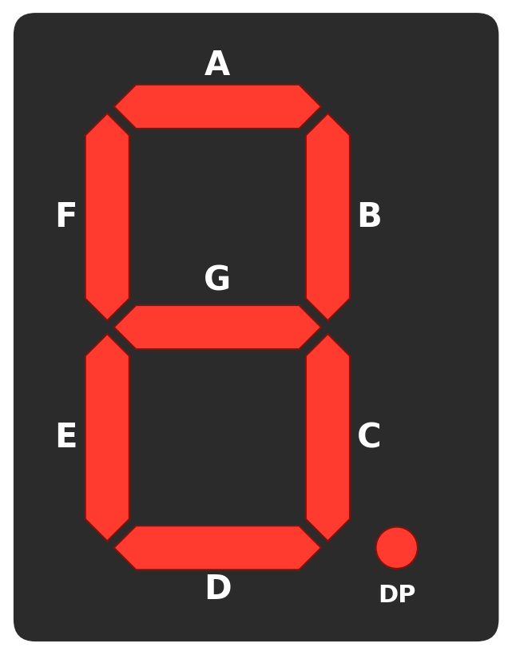
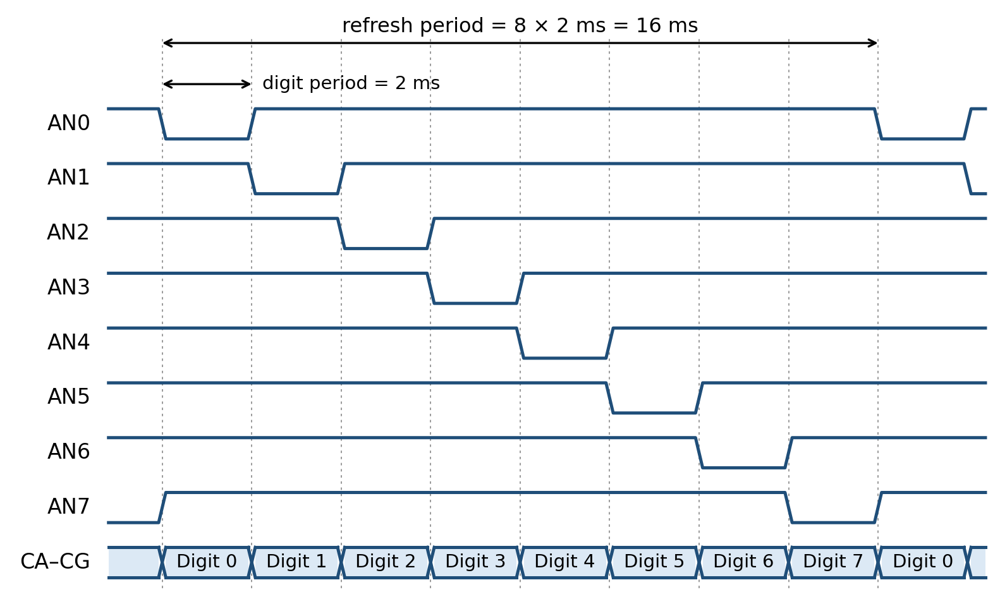
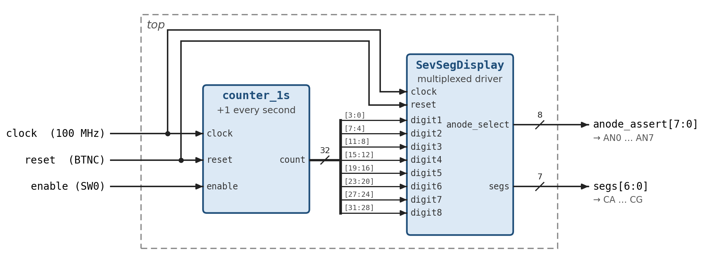
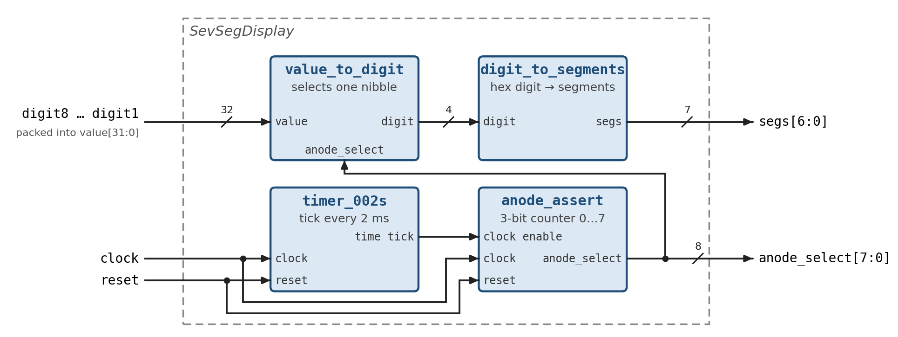

# Fifth exercise: Counter and seven segment display 


## Seven segment display 

A seven-segment display is an electronic display device used to show decimal digits and some letters. It consists of seven bar-shaped LEDs arranged in a figure eight. Each LED is called a segment because, when lit, it forms one part of the character being displayed. Most displays also include an eighth LED, the decimal point (DP), in the lower right corner.

{#fig-sevenseg-layout width=220 fig-align="center"}

As @fig-sevenseg-layout shows, segment A sits at the top and the labels run clockwise through B, C, D, E and F. Segment G is the middle bar. Lighting different combinations of segments produces the digits 0 to 9 and the hexadecimal letters A to F. For example, the digit 1 lights only B and C, while the digit 8 lights all seven segments.

### Common anode vs common cathode configuration

Each segment is an LED, and an LED lights up only when current flows from its anode (positive terminal) to its cathode (negative terminal). To save pins, the eight LEDs of one digit share a common terminal. Which terminal they share determines the logic level that turns a segment on.

- **Common anode (CA).** All anodes are tied together and held at logic 1. Each cathode has its own control signal. Driving a cathode to logic 0 lets current flow, so the segment lights. Driving it to logic 1 leaves both terminals at the same level, so the segment stays dark. The segments are therefore **active low**.
- **Common cathode (CC).** All cathodes are tied together and held at logic 0. Each anode has its own control signal. Driving an anode to logic 1 lights the segment, and driving it to logic 0 turns it off. The segments are therefore **active high**.

| Configuration | Common terminal | Segment on | Segment off |
|---------------|-----------------|------------|-------------|
| **Common anode (CA)** | Anodes at logic 1 | Cathode at logic 0 | Cathode at logic 1 |
| **Common cathode (CC)** | Cathodes at logic 0 | Anode at logic 1 | Anode at logic 0 |

The Nexys A7 uses common anode displays. Keep this in mind when you write the segment patterns: a segment that should be lit needs a 0 in your code, not a 1.

### Nexys A7 and seven-segment display

The Nexys A7 has eight common anode seven-segment digits. They are wired to the FPGA with two groups of signals:

- **Cathodes CA to CG (and DP).** These are shared by all eight digits. Segment CA on digit 0 is wired to segment CA on every other digit. A cathode at logic 0 lights its segment.
- **Anodes AN0 to AN7.** Each digit has its own anode signal, which switches that digit on or off. An anode at logic 0 turns its digit on.

> **Note:** You might expect the anode signals to be active high, since they drive the common anode. On the board, however, each ANx signal controls a transistor that switches the supply to its digit. That transistor conducts when ANx is at logic 0. So both the anodes and the cathodes are active low. See Figure 9.1 in the [Nexys A7 reference manual](https://digilent.com/reference/programmable-logic/nexys-a7/reference-manual).

The board has only one set of cathode signals, so at any moment all enabled digits show the same pattern. To display eight different digits, the design uses **time multiplexing**. It enables one digit at a time and puts that digit's pattern on the shared cathodes. Then it moves on to the next digit, and so on in a continuous loop:

1. Set AN0 to logic 0 and all other anodes to logic 1. Drive the cathodes with the pattern for digit 0. Only digit 0 lights.
2. After a short time, set AN1 to logic 0 and the rest to logic 1. Drive the cathodes with the pattern for digit 1. Only digit 1 lights.
3. Continue the same way up to AN7, then start again at AN0.

{#fig-sevenseg-multiplex width=100%}

@fig-sevenseg-multiplex shows the timing used in this lab. Each digit is on for a **digit period** of 2 ms, so one pass over all eight digits takes a **refresh period** of 8 × 2 ms = 16 ms. Each digit is lit only one eighth of the time. It still looks steady because of persistence of vision: when the refresh rate is above roughly 60 Hz, the eye cannot see the flicker. Here the refresh rate is 1 / 16 ms = 62.5 Hz. If the digit period is too long, the display visibly flickers. If it is too short, the digits look dim and can bleed into each other, because the LEDs do not have time to switch fully. The reference manual recommends a refresh period between 1 ms and 16 ms.


## Assignment

In this assignment you will build a seconds counter on the Nexys A7. The counter value appears on all eight seven-segment digits as a hexadecimal number. Switch SW0 starts and stops counting, and the centre button BTNC resets the counter to zero.

### Design overview

The design has two levels of hierarchy. @fig-sevseg-top shows the top level. `counter_1s` produces a 32-bit count that increases once per second. `SevSegDisplay` splits that count into eight 4-bit hex digits and drives the display with time multiplexing.

{#fig-sevseg-top width=100%}

@fig-sevseg-display shows what is inside `SevSegDisplay`. `timer_002s` produces a tick every 2 ms. On each tick, `anode_assert` moves to the next digit by driving one anode low. `value_to_digit` uses the same anode pattern to pick the matching nibble of the count. `digit_to_segments` turns that nibble into the cathode pattern.

{#fig-sevseg-display width=100%}

Build the design bottom up. Write each small module first and check it in simulation, then connect the modules together. All module skeletons are in the starter file [top_draft.sv](../code/05_lab/top_draft.sv).

### Step 1: Create the project

Create a new Anvil project for the Nexys A7 100T, as in the [tools intro](01-tools-intro.qmd):

```bash
mkdir counter_7seg && cd counter_7seg
anvil init --board Nexys-A7-100T
```

Replace the contents of `top.sv` with the contents of [top_draft.sv](../code/05_lab/top_draft.sv). It contains empty skeletons of every module in this assignment. You will fill them in during the following steps.

### Step 2: `timer_002s`

This module produces a `time_tick` pulse that is high for exactly one clock cycle every 2 ms. It sets the digit period from @fig-sevenseg-multiplex.

```verilog
module timer_002s
    (
        input logic clock,
        input logic reset,
        output logic time_tick
    );
endmodule
```

1. Work out how many clock cycles fit in 2 ms. The clock runs at 100 MHz, so one cycle is 10 ns and 2 ms is 2 ms / 10 ns = 200 000 cycles.
2. Declare a counter register wide enough to hold 199 999. That needs 18 bits, because 2^18 = 262 144.
3. In an `always_ff` block, reset the counter to 0 when `reset` is high. Otherwise, increment it on every clock edge. When it reaches 199 999, wrap it back to 0.
4. Drive `time_tick` high only while the counter equals 199 999. This gives one pulse per 200 000 cycles.

This is the same idea as the prescaler from the [previous exercise](04-structural-modeling.qmd). A good alternative is to write one parametrized timer, `timer #(parameter LIMIT = 200_000)`, and use it in both this step and the next. That also makes simulation easier, as Step 9 explains.

### Step 3: `counter_1s`

This module holds the 32-bit count. The count increases by one every second while `enable` is high, and holds its value while `enable` is low.

```verilog
module counter_1s
    (
        input logic clock,
        input logic reset,
        input logic enable,
        output logic [31:0] count
    );
endmodule
```

1. Inside the module, build a 1 s tick in the same way as in Step 2. One second is 100 000 000 cycles, so the prescaler counts from 0 to 99 999 999. That needs 27 bits.
2. Add a second register for `count`. Reset it to 0 when `reset` is high.
3. Increment `count` only on clock cycles where the 1 s tick is high **and** `enable` is high. On all other cycles, keep the old value.

Increment `count` on the system clock and use the tick as a condition. Do not use the tick as a clock. All flip-flops in the design should share the 100 MHz clock.

### Step 4: `anode_assert`

This module selects which digit is active. It has a 3-bit counter that advances on every 2 ms tick and turns the counter value into an active-low anode pattern.

```verilog
module anode_assert (
    input logic clock,
    input logic reset,
    input logic clock_enable,       // time_tick from timer_002s
    output logic [7:0] anode_select
);
    logic [2:0] count;
    assign anode_select = ~(8'b1 << count);
endmodule
```

1. Write an `always_ff` block that resets `count` to 0 and increments it whenever `clock_enable` is high. A 3-bit counter wraps from 7 back to 0 on its own, so no extra comparison is needed.
2. The `assign` line is already given. Shifting `1` left by `count` sets exactly one bit, and the `~` inverts it so that exactly one anode is at logic 0:

| `count` | `anode_select` | Active digit |
|---------|----------------|--------------|
| 0 | `8'b1111_1110` (`8'hFE`) | AN0, rightmost |
| 1 | `8'b1111_1101` (`8'hFD`) | AN1 |
| 2 | `8'b1111_1011` (`8'hFB`) | AN2 |
| … | … | … |
| 7 | `8'b0111_1111` (`8'h7F`) | AN7, leftmost |

### Step 5: `value_to_digit`

This purely combinational module picks the nibble of the 32-bit value that belongs to the active digit.

```verilog
module value_to_digit(
    input logic [31:0] value,
    input logic [7:0] anode_select,
    output logic [3:0] digit
);
endmodule
```

1. Write an `always_comb` block with a `case` statement on `anode_select`.
2. Add one branch per row of the table in Step 4. For `8'hFE` output `value[3:0]`, for `8'hFD` output `value[7:4]`, and so on up to `8'h7F`, which outputs `value[31:28]`.
3. Add a `default` branch that outputs `4'h0`. Without it, synthesis infers a latch.

### Step 6: `digit_to_segments`

This purely combinational module converts a 4-bit hex digit into the seven cathode signals. Two rules from the introduction apply here:

- The bit order is `segs[6:0] = {G, F, E, D, C, B, A}`. So `segs[0]` drives segment A and `segs[6]` drives segment G (see @fig-sevenseg-layout).
- The cathodes are active low. A segment that should light needs a **0**.

```verilog
module digit_to_segments (
    input logic [3:0] digit,
    output logic [6:0] segs
);
endmodule
```

1. For each hex digit, list the segments that must light. The table below gives them.
2. Write the 7-bit pattern in the order G F E D C B A. Put a 0 for every lit segment and a 1 for every dark one.
3. Implement the table as a `case` statement inside `always_comb`, with one branch per digit.

As a worked example, take the digit 2. It lights A, B, D, E and G, and leaves C and F dark. Reading G F E D C B A gives 0 1 0 0 1 0 0, so `segs = 7'b0100100`.

| Digit | Lit segments | `segs` (G…A) |
|-------|--------------|--------------|
| 0 | A B C D E F | `7'b1000000` |
| 1 | B C | `7'b1111001` |
| 2 | A B D E G | `7'b0100100` |
| 3 | A B C D G | |
| 4 | B C F G | |
| 5 | A C D F G | |
| 6 | A C D E F G | |
| 7 | A B C | |
| 8 | A B C D E F G | |
| 9 | A B C D F G | |
| A | A B C E F G | |
| b | C D E F G | |
| C | A D E F | |
| d | B C D E G | |
| E | A D E F G | |
| F | A E F G | |

Fill in the missing patterns yourself. Lowercase b and d are used so they do not look like 8 and 0.

### Step 7: `SevSegDisplay`

Now connect the four modules as shown in @fig-sevseg-display.

```verilog
module SevSegDisplay (
    input logic clock,
    input logic reset,
    input logic [3:0] digit1, // least significant digit, shown on AN0
    input logic [3:0] digit2,
    input logic [3:0] digit3,
    input logic [3:0] digit4,
    input logic [3:0] digit5,
    input logic [3:0] digit6,
    input logic [3:0] digit7,
    input logic [3:0] digit8, // most significant digit, shown on AN7
    output logic [7:0] anode_select,
    output logic [6:0] segs
);
    logic [31:0] digit;
    assign digit = {digit8, digit7, digit6, digit5, digit4, digit3, digit2, digit1};
endmodule
```

1. Declare two internal signals: `logic time_tick` and `logic [3:0] current_digit`. Do not name the 4-bit signal `digit`, because the skeleton already uses `digit` for the packed 32-bit value.
2. Instantiate `timer_002s`. Connect `clock` and `reset`, and connect its output to `time_tick`.
3. Instantiate `anode_assert`. Connect `clock`, `reset` and `.clock_enable(time_tick)`. Connect its output straight to the module output `anode_select`.
4. Instantiate `value_to_digit` with `.value(digit)`, `.anode_select(anode_select)` and `.digit(current_digit)`. This is the feedback path in the figure. The same anode pattern that drives the display also selects the nibble.
5. Instantiate `digit_to_segments` with `.digit(current_digit)` and connect its output to the module output `segs`.

### Step 8: `top`

The top module connects the counter to the display, as shown in @fig-sevseg-top.

```verilog
module top (
    input logic clock,
    input logic reset,
    input logic enable,
    output logic [7:0] anode_assert,
    output logic [6:0] segs
);
endmodule
```

1. Declare an internal signal `logic [31:0] count`.
2. Instantiate `counter_1s` and connect `clock`, `reset`, `enable` and `count`.
3. Instantiate `SevSegDisplay`. Connect `clock` and `reset`. Then connect the eight nibbles of `count`: `.digit1(count[3:0])`, `.digit2(count[7:4])`, and so on up to `.digit8(count[31:28])`.
4. Connect `.anode_select(anode_assert)` and `.segs(segs)` to the top-level outputs.

### Step 9: Simulate

Simulate before you build. Finding a bug in GTKWave takes minutes. Finding it on the board takes much longer.

With the real limits, one second of hardware time is 100 million clock cycles, which is far too slow to simulate. Temporarily shrink the limits instead. For example, make the 2 ms timer tick every 4 cycles and the 1 s timer every 64 cycles. A parametrized timer from Step 2 makes this a one-line change. Remember to restore the real values before you build.

Use [top_tb.sv](../code/05_lab/top_tb.sv) as a starting point. Put it in the project's `tb/` folder and run it:

```bash
anvil test tb/top_tb.sv
gtkwave tb/top_tb.vcd &
```

In the waveform, check that:

- `anode_assert` steps through `FE`, `FD`, `FB`, … `7F` and then starts again at `FE`.
- `segs` shows the correct pattern for the nibble selected by each anode value.
- `count` increases only while `enable` is high, and returns to 0 when `reset` is pressed.

It also helps to test `digit_to_segments` on its own with a small testbench that loops through all 16 digits.

### Step 10: Pin constraints

Map the top-level ports to the board pins in the project's `.xdc` file, following the same pattern as in the [tools intro](01-tools-intro.qmd). The clock is the 100 MHz oscillator, `enable` is SW0, `reset` is BTNC, and the outputs go to the seven-segment cathodes and anodes:

```
## Clock signal
set_property PACKAGE_PIN E3 [get_ports {clock}]
set_property IOSTANDARD LVCMOS33 [get_ports {clock}]
create_clock -period 10.0 [get_ports {clock}]

## Switch SW0
set_property PACKAGE_PIN J15 [get_ports {enable}]
set_property IOSTANDARD LVCMOS33 [get_ports {enable}]

## Button BTNC
set_property PACKAGE_PIN N17 [get_ports {reset}]
set_property IOSTANDARD LVCMOS33 [get_ports {reset}]

## Seven-segment cathodes CA to CG
set_property PACKAGE_PIN T10 [get_ports {segs[0]}]
set_property IOSTANDARD LVCMOS33 [get_ports {segs[0]}]
set_property PACKAGE_PIN R10 [get_ports {segs[1]}]
set_property IOSTANDARD LVCMOS33 [get_ports {segs[1]}]
set_property PACKAGE_PIN K16 [get_ports {segs[2]}]
set_property IOSTANDARD LVCMOS33 [get_ports {segs[2]}]
set_property PACKAGE_PIN K13 [get_ports {segs[3]}]
set_property IOSTANDARD LVCMOS33 [get_ports {segs[3]}]
set_property PACKAGE_PIN P15 [get_ports {segs[4]}]
set_property IOSTANDARD LVCMOS33 [get_ports {segs[4]}]
set_property PACKAGE_PIN T11 [get_ports {segs[5]}]
set_property IOSTANDARD LVCMOS33 [get_ports {segs[5]}]
set_property PACKAGE_PIN L18 [get_ports {segs[6]}]
set_property IOSTANDARD LVCMOS33 [get_ports {segs[6]}]

## Seven-segment anodes AN0 to AN7
set_property PACKAGE_PIN J17 [get_ports {anode_assert[0]}]
set_property IOSTANDARD LVCMOS33 [get_ports {anode_assert[0]}]
set_property PACKAGE_PIN J18 [get_ports {anode_assert[1]}]
set_property IOSTANDARD LVCMOS33 [get_ports {anode_assert[1]}]
set_property PACKAGE_PIN T9 [get_ports {anode_assert[2]}]
set_property IOSTANDARD LVCMOS33 [get_ports {anode_assert[2]}]
set_property PACKAGE_PIN J14 [get_ports {anode_assert[3]}]
set_property IOSTANDARD LVCMOS33 [get_ports {anode_assert[3]}]
set_property PACKAGE_PIN P14 [get_ports {anode_assert[4]}]
set_property IOSTANDARD LVCMOS33 [get_ports {anode_assert[4]}]
set_property PACKAGE_PIN T14 [get_ports {anode_assert[5]}]
set_property IOSTANDARD LVCMOS33 [get_ports {anode_assert[5]}]
set_property PACKAGE_PIN K2 [get_ports {anode_assert[6]}]
set_property IOSTANDARD LVCMOS33 [get_ports {anode_assert[6]}]
set_property PACKAGE_PIN U13 [get_ports {anode_assert[7]}]
set_property IOSTANDARD LVCMOS33 [get_ports {anode_assert[7]}]
```

The decimal point (DP, pin H15) is not used in this design. If you leave it unconnected, it stays dark.

### Step 11: Build and program

Check that the timer limits are back at their real values (200 000 and 100 000 000). Then build and program the board:

```bash
anvil build
anvil program
```

All eight digits should show `00000000`. Turn on SW0, and the rightmost digit should count up once per second: 1, 2, … 9, A, b, … F. Then the next digit increments to 1. Turning SW0 off freezes the value, and pressing BTNC clears it to zero.

If the display looks wrong, use these hints:

- **All segments lit, or the digits look like garbled 8s:** the segment patterns are probably inverted. Remember that a lit segment needs a 0.
- **The same digit appears on every position:** check the `case` in `value_to_digit` and the connection from `anode_select` to it.
- **The digits flicker visibly:** the 2 ms timer is too slow. Check the limit in `timer_002s`.

## Starter files

- [top_draft.sv](../code/05_lab/top_draft.sv)
- [top_tb.sv](../code/05_lab/top_tb.sv)
