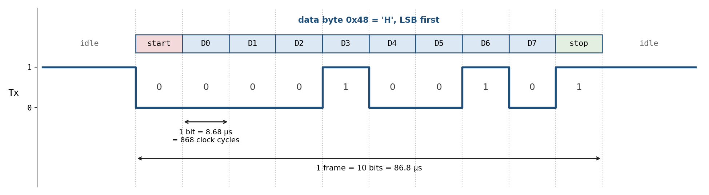
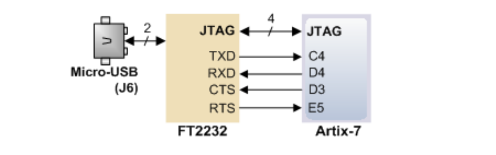
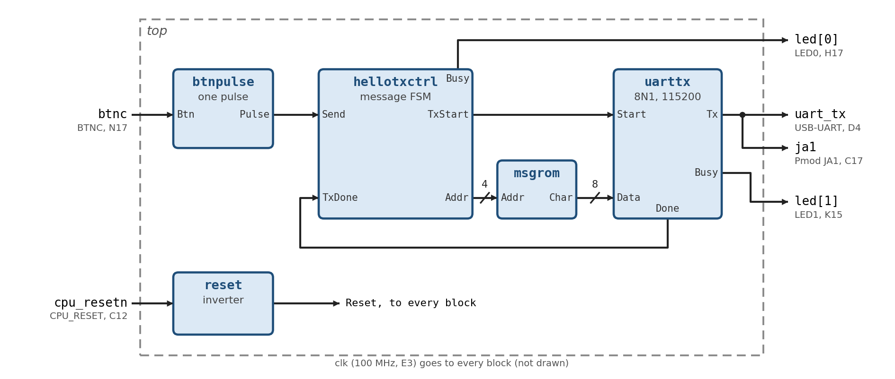
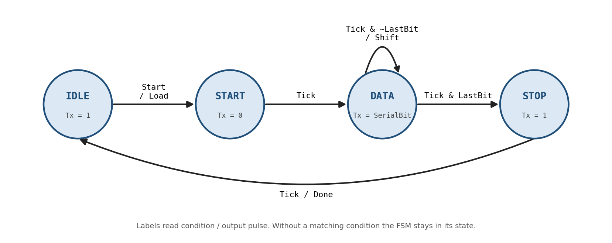
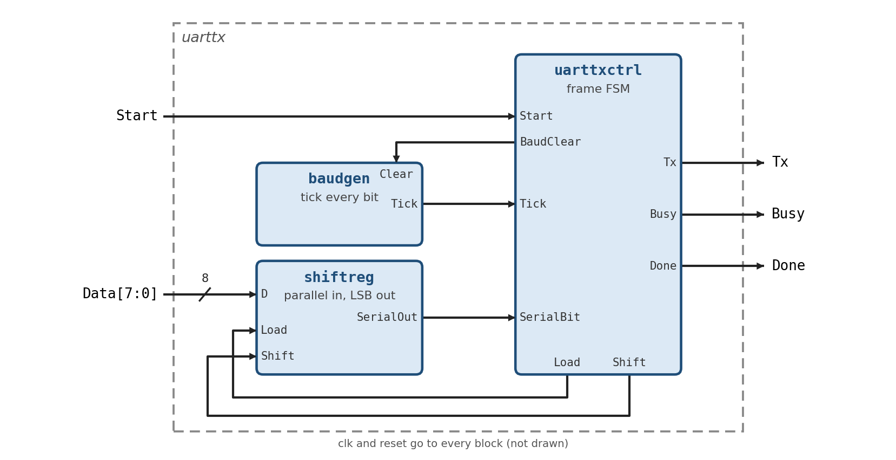
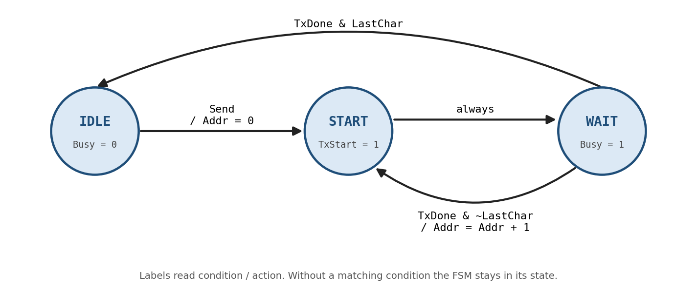

# Sixth exercise: UART transmitter

So far the board could only talk to you through LEDs and the seven-segment display. In this exercise you will give it a voice. You will build a UART transmitter and use it to send the text `Hello World!` from the FPGA to a terminal on your computer, over the same USB cable you use to program the board.

UART is the simplest serial interface there is, and it is everywhere: microcontroller debug consoles, GPS modules, Bluetooth modules, and the console of the HIPV SoC you will meet later in the course. The HIPV SoC prints its messages through a UART peripheral that contains the same building blocks you write here. This exercise is also the first one written to the HIPV coding convention, which the project assignments also require.

## UART basics

UART stands for *Universal Asynchronous Receiver-Transmitter*. "Asynchronous" means there is no clock wire between the two devices. The transmitter sends bits on a single wire, called TX, and the receiver has to work out on its own when each bit starts and ends. This only works because both sides agree in advance on two things:

- **The baud rate**, the number of bits per second. Common values are 9600, 19200 and 115200 baud. Every bit lasts exactly one bit period, 1 / baud rate.
- **The frame format**, which describes how each byte is wrapped on the wire.

### The UART frame

When nothing is being sent, the line sits at logic 1. This is called the **idle** state. Each byte is then sent as one frame:

1. **Start bit.** The transmitter pulls the line to 0 for one bit period. The falling edge from idle to 0 tells the receiver that a frame is starting.
2. **Data bits.** Usually 8 bits, sometimes 5 to 9. The **least significant bit goes first**.
3. **Parity bit (optional).** An extra bit for simple error detection. With even parity it makes the number of 1s in the data and parity bits even.
4. **Stop bit.** The line returns to 1 for at least one bit period (sometimes 1.5 or 2). This guarantees that the next start bit has a falling edge.

The frame format is written as a short code: data bits, parity (N for none, E for even, O for odd) and stop bits. The most common format, and the one used in this exercise, is **8N1**: 8 data bits, no parity, 1 stop bit. An 8N1 frame is 10 bits long, so a byte takes 10 bit periods.

{#fig-uart-frame width=100%}

@fig-uart-frame shows the frame for the letter `H`. Its ASCII code is 0x48, or `0100 1000` in binary. Because the LSB goes first, bit D0 on the wire is the rightmost bit of the binary number. Reading the wire from left to right gives the binary number backwards.

### Baud rate and clock cycles

Inside the FPGA, everything is measured in clock cycles. The Nexys A7 clock runs at 100 MHz, so the number of clock cycles in one bit period is

```
LIMIT = CLK_FREQ / BAUD_RATE = 100 000 000 / 115 200 = 868.06  ->  868
```

The division does not come out even, so the transmitter really runs at 100 000 000 / 868 = 115 207 baud. That is only 0.006 % fast. A UART receiver samples each bit in its middle (see the next section), so the two sides can differ by a few percent before a bit is read wrongly. With a slow baud rate and a fast clock, rounding errors like this one never matter.

### How a receiver reads the frame

The receiver waits for the falling edge of the start bit. It then waits half a bit period, which brings it to the middle of the start bit, and checks that the line is still 0. After that it waits one full bit period at a time and samples the line in the middle of each data bit, and finally checks that the stop bit is 1. The testbenches in this exercise decode the TX line in exactly this way.

Sampling in the middle of the bit is what makes the scheme robust. Small differences between the transmitter and receiver clocks shift the sampling point a little on every bit, but it stays inside the bit as long as the total drift over a frame is less than half a bit.

## UART on the Nexys A7

You do not need a separate cable for the UART. The Nexys A7 has an FTDI FT2232 chip behind its micro-USB port. One half of the chip is the JTAG programmer that `anvil program` uses. The other half is a USB-UART bridge, which your computer sees as a serial port.

{#fig-uart-nexys width=70%}

Be careful with the signal names in @fig-uart-nexys and in the board's master `.xdc` file. They are named from the bridge's point of view, not the FPGA's:

| Pin | Name in the `.xdc` | Direction | Use in this exercise |
|-----|--------------------|-----------|----------------------|
| D4 | `UART_RXD_OUT` | FPGA → computer | our `uart_tx` |
| C4 | `UART_TXD_IN` | computer → FPGA | not used (receiving) |
| D3, E5 | `UART_CTS`, `UART_RTS` | flow control | not used |

So the FPGA's transmit pin is the one Digilent calls *RXD*, because it is the bridge's receive input. This is easy to get backwards, so double-check it when you write the constraints.


## Assignment

You will build the design in two parts:

- **Part A**, the UART transmitter `uarttx`. It takes one byte and a start pulse, and sends the byte as an 8N1 frame at 115200 baud.
- **Part B**, a message sender. Pressing the centre button BTNC sends `Hello World!` followed by a new line to the terminal.

{#fig-hello-top width=100%}

@fig-hello-top shows the complete design. `btnpulse` turns a press of BTNC into a single clock-cycle pulse. `hellotxctrl` then steps an address through the message stored in `msgrom`. For each character it starts `uarttx` and waits until the frame is finished before moving on. The serial line goes to the USB-UART bridge and is also copied to Pmod pin JA1, so you can look at it with the oscilloscope. Two LEDs show when a message and when a single character are being sent.

The starter files are listed below. Files marked *given* are complete. Do not change them. The others contain the module interface and `TODO` comments that describe what to write.

| File | Status | Contents |
|------|--------|----------|
| [flopenr.sv](../code/06_lab/flopenr.sv) | given | HIPV generic flip-flop with reset and enable |
| [mux2.sv](../code/06_lab/mux2.sv) | given | HIPV generic 2-to-1 multiplexer |
| [baudgen.sv](../code/06_lab/baudgen.sv) | complete it | baud rate generator (Step 2) |
| [shiftreg.sv](../code/06_lab/shiftreg.sv) | complete it | parallel-in, serial-out shift register (Step 3) |
| [uarttxctrl.sv](../code/06_lab/uarttxctrl.sv) | complete it | transmitter control FSM (Step 4) |
| [uarttx.sv](../code/06_lab/uarttx.sv) | complete it | transmitter, connects the three blocks above (Step 5) |
| [msgrom.sv](../code/06_lab/msgrom.sv) | complete it | the message text (Step 7) |
| [hellotxctrl.sv](../code/06_lab/hellotxctrl.sv) | complete it | message sender FSM (Step 8) |
| [btnpulse.sv](../code/06_lab/btnpulse.sv) | given | turns a button press into a one-cycle pulse |
| [top.sv](../code/06_lab/top.sv) | complete it | board wrapper (Step 9) |
| [uarttx_tb.sv](../code/06_lab/uarttx_tb.sv) | given | self-checking testbench for `uarttx` |
| [top_tb.sv](../code/06_lab/top_tb.sv) | given | system testbench, decodes the message |

### Step 1: Create the project

Create a new Anvil project for the Nexys A7 100T, as in the [tools intro](01-tools-intro.qmd):

```bash
mkdir uart_hello && cd uart_hello
anvil init --board Nexys-A7-100T
```

Copy all ten `.sv` design files into the project root, replacing the generated `top.sv`. Copy the two testbenches into `tb/`. You can download them all at once by running this command inside the `uart_hello` folder:

```bash
rm -f top.sv; B=https://raw.githubusercontent.com/laspp/digital_design_lab/main/code/06_lab; wget -q $B/{top,uarttx,uarttxctrl,baudgen,shiftreg,hellotxctrl,msgrom,btnpulse,flopenr,mux2}.sv && wget -q -P tb $B/{uarttx_tb,top_tb}.sv
```

It first removes the `top.sv` generated by `anvil init`. Otherwise `wget` would save the starter file as `top.sv.1` next to it. The `{...}` part expands into one URL per file, and `-P tb` puts the testbenches into `tb/`. On macOS, install `wget` first with `brew install wget`.

The project should then look like this:

```
uart_hello/
  config.json
  Nexys-A7-100T-Master.xdc
  top.sv  uarttx.sv  uarttxctrl.sv  baudgen.sv  shiftreg.sv
  hellotxctrl.sv  msgrom.sv  btnpulse.sv  flopenr.sv  mux2.sv
  tb/
    uarttx_tb.sv
    top_tb.sv
```

Anvil compiles every `.sv` file in the project root, for both `anvil build` and `anvil test`. One module per file therefore needs no extra configuration. Just keep the design files in the root and the testbenches in `tb/`.

### Step 2: `baudgen`

The baud rate generator is a counter that produces a one-cycle `Tick` once every bit period. It is the same idea as the prescaler from the [fourth exercise](04-structural-modeling.qmd) and the 2 ms timer from the [fifth](05-counter-sevenseg.qmd), with one addition: a `Clear` input.

```systemverilog
module baudgen #(parameter LIMIT = 868) (
  input  logic clk, reset,
  input  logic Clear,
  output logic Tick);

  localparam WIDTH = $clog2(LIMIT);
  localparam logic [WIDTH-1:0] LAST_COUNT = WIDTH'(LIMIT - 1);

  logic [WIDTH-1:0] Count;
endmodule
```

1. `WIDTH` and `LAST_COUNT` are already worked out from `LIMIT`. `$clog2(868)` is 10, because 2^10 = 1024 is the smallest power of two above 868. The cast `WIDTH'(...)` resizes the 32-bit result of `LIMIT - 1` to `WIDTH` bits, so the comparison below has matching widths.
2. Write an `always_ff` block. When `reset`, `Clear` or `Tick` is high, set `Count` to 0. Otherwise increment it.
3. Drive `Tick` high while `Count` equals `LAST_COUNT`. Because the counter goes back to 0 on the cycle after `Tick`, one period is exactly `LIMIT` cycles.

Why `Clear`? A frame can start at any moment. Without `Clear`, the counter would be somewhere in the middle of its period when the start bit begins, and the start bit would be shorter than one bit period. The control FSM holds `Clear` high while it is idle. The counter therefore starts from 0 together with the start bit, and every bit of the frame is exactly `LIMIT` cycles long.

### Step 3: `shiftreg`

The shift register holds the byte being sent and presents it one bit at a time, LSB first, on `SerialOut`.

```systemverilog
module shiftreg #(parameter WIDTH = 8) (
  input  logic             clk, reset,
  input  logic             Load, Shift,
  input  logic [WIDTH-1:0] D,
  output logic             SerialOut);
```

| `Load` | `Shift` | Next value of `Q` |
|--------|---------|-------------------|
| 1 | x | `D`, the new byte |
| 0 | 1 | `{1'b0, Q[WIDTH-1:1]}`, shifted right by one |
| 0 | 0 | `Q`, unchanged |

This module is a datapath, so the convention asks for a structural description. Build it from the two generic cells, as the HIPV instruction fetch unit does for its PC register. @fig-shiftreg-block shows the structure.

{#fig-shiftreg-block width=100%}

Follow these steps:

1. Assign `ShiftedQ = {1'b0, Q[WIDTH-1:1]}`. Every bit moves one place down and a 0 enters at the top.
2. Instantiate `mux2 #(WIDTH) loadmux`. It selects `D` when `Load` is 1 and `ShiftedQ` otherwise. Its output is `NextQ`.
3. Assign `En = Load | Shift`.
4. Instantiate `flopenr #(WIDTH) datareg`. It stores `NextQ` into `Q` when `En` is high.
5. Assign `SerialOut = Q[0]`. After a load, `Q[0]` is D0. Each shift brings the next bit into position 0.

The port names of the generic cells are `D0`, `D1`, `S`, `Y` for `mux2` and `clk`, `reset`, `en`, `D`, `Q` for `flopenr`.

### Step 4: `uarttxctrl`

The control FSM sequences the frame. It has four states, one for each part of the frame, as shown in @fig-uarttx-fsm.

{#fig-uarttx-fsm width=100%}

- **IDLE.** The line is 1. When `Start` arrives, the FSM pulses `Load` so the shift register captures `Data`, and moves to START.
- **START.** The line is 0 for one bit period. On `Tick`, move to DATA.
- **DATA.** The line carries `SerialBit`. On every `Tick`, one bit is finished. If it was not the last bit, pulse `Shift` to bring up the next bit and stay in DATA. After the last bit, move to STOP.
- **STOP.** The line is 1 for one bit period. On `Tick`, pulse `Done` and return to IDLE.

A 3-bit counter `BitCount` keeps track of which data bit is on the line. It is cleared in START and incremented on every `Tick` in DATA. `LastBit` is high while it equals `DATA_BITS - 1`, which is 7.

The skeleton gives you the state type and the state register, written in the same style as the HIPV core's FSMs:

```systemverilog
  typedef enum logic [1:0] {IDLE, START, DATA, STOP} statetype;

  statetype             State, NextState;
  logic [CNT_WIDTH-1:0] BitCount;
  logic                 LastBit, TxNext;

  // state register
  always_ff @(posedge clk)
    if (reset) State <= IDLE;
    else       State <= NextState;
```

1. Write the bit counter as described above.
2. Write the next state logic as an `always_comb` block with a `case` on `State`. Start with `NextState = State`, so that every state holds unless a transition applies, and add a `default` branch.
3. Write a second `always_comb` block that sets `TxNext`: 0 in START, `SerialBit` in DATA, and 1 in IDLE and STOP.
4. Register the line: `Tx <= TxNext` on every clock edge, with **reset value 1**.
5. Drive the remaining outputs with `assign`:

| Output | High when |
|--------|-----------|
| `Load` | in IDLE and `Start` is high |
| `Shift` | in DATA, `Tick` is high and it is not the last bit |
| `BaudClear` | in IDLE |
| `Busy` | in any state other than IDLE |
| `Done` | in STOP and `Tick` is high |

::: {.callout-warning}
## Do not infer latches in the next state logic

An `always_comb` block describes combinational logic only if it assigns every signal on every path through the block. If some path leaves `NextState` unassigned, the signal has to keep its old value on that path. Combinational logic cannot remember anything, so synthesis adds a **latch**, a level-sensitive storage element, to hold the value. A latch is not what you meant. It makes the timing unpredictable, and the design can behave differently on the board than in simulation.

This happens easily in an FSM. The following next state logic infers a latch:

```systemverilog
always_comb
  case (State)
    IDLE:  if (Start) NextState = START;  // no else: NextState is not assigned
    START: if (Tick)  NextState = DATA;
    ...
  endcase
```

In IDLE without `Start`, nothing assigns `NextState`. Two habits prevent this:

- Give every signal a default value at the top of the block, before the `case`. `NextState = State;` means "stay in the current state" on every path that does not assign a transition.
- Always add a `default` branch to the `case`, even when the listed states seem to cover every value.

The same applies to `TxNext` here and to the next state logic of `hellotxctrl` in Step 8. Check the output of `anvil build`. When Yosys finds a latch, it prints `Latch inferred for signal ...` with the signal's name. If you see this message, look for the path that does not assign that signal.
:::

Why register `Tx` instead of assigning `TxNext` to it directly? `TxNext` is combinational logic driven by the state register and the shift register. When both change on the same clock edge, the output of that logic can glitch for a few nanoseconds before it settles. On an internal signal that would not matter, because the next clock edge only samples the settled value. The TX line, however, goes off the chip to a receiver that does not share our clock. A short glitch to 0 on an idle line looks exactly like the start of a frame. A flip-flop output changes only once per clock edge, so registering `Tx` makes the line clean. The reset value of 1 matters for the same reason: the line must be idle, not 0, from the moment the FPGA starts.

The register delays the line by one clock cycle. It delays every bit by the same cycle, so the bit lengths are unchanged.

### Step 5: `uarttx`

Now connect the three blocks as shown in @fig-uarttx-block.

{#fig-uarttx-block width=100%}

```systemverilog
module uarttx #(parameter CLK_FREQ = 100_000_000, BAUD_RATE = 115_200) (
  input  logic       clk, reset,
  input  logic       Start,
  input  logic [7:0] Data,
  output logic       Tx,
  output logic       Busy, Done);

  localparam LIMIT = CLK_FREQ / BAUD_RATE;
```

1. Instantiate `baudgen #(LIMIT) baud`.
2. Instantiate `shiftreg #(8) datareg` with `.D(Data)` and `.SerialOut(SerialBit)`.
3. Instantiate `uarttxctrl #(8) ctrl`.

All internal signals are already declared. Connect every port by name, as the convention requires.

### Step 6: Simulate the transmitter

Simulate the transmitter before going further. At 115200 baud a frame is 8680 clock cycles long, which is a lot to scroll through in a waveform viewer. The testbench avoids this by instantiating `uarttx` with `BAUD_RATE = 10_000_000`, so `LIMIT` is only 10 cycles. Because the baud rate is a parameter, you do not have to edit the design to make simulation faster, unlike the timers in the previous exercise.

```bash
anvil test tb/uarttx_tb.sv
gtkwave tb/uarttx_tb.vcd &
```

The testbench sends five bytes and decodes the `Tx` line with the mid-bit sampling described earlier. A working transmitter prints:

```
OK:    sent 0x55, received 0x55
OK:    sent 0xa3, received 0xa3
OK:    sent 0x48, received 0x48
OK:    sent 0x00, received 0x00
OK:    sent 0xff, received 0xff
PASS: all frames correct
```

If the design never produces a frame, the testbench stops after 200 µs with a `FAIL: timeout` message instead of running forever. In the waveform, check that:

- `Tx` is 1 after reset and between frames.
- The start bit, every data bit and the stop bit are each exactly 10 clock cycles long.
- For 0x55 (`0101 0101`), the line alternates 0, 1, 0, 1, … after the start bit, since D0 is 1.
- `Busy` is high for the whole frame, and `Done` is a single-cycle pulse at the end of the stop bit.

### Step 7: `msgrom`

The message is stored in a small read-only memory, written as a `case` statement that maps an address to a character.

```systemverilog
module msgrom (input  logic [3:0] Addr,
               output logic [7:0] Char);
```

The message is `Hello World!` followed by two control characters. **Carriage return** (CR, 0x0D) moves the terminal cursor to the start of the line, and **line feed** (LF, 0x0A) moves it down one line. Together they start a new line, so each press of the button prints the message on its own line. That makes 14 characters, at addresses 0 to 13.

The skeleton already has `H`, `e`, CR, LF and the `default` branch. Fill in addresses 2 to 11 using an ASCII table. These are the codes you need:

| Character | ASCII | | Character | ASCII |
|-----------|-------|-|-----------|-------|
| space | 0x20 | | `l` | 0x6C |
| `!` | 0x21 | | `o` | 0x6F |
| `W` | 0x57 | | `r` | 0x72 |
| `d` | 0x64 | | `e` | 0x65 |

### Step 8: `hellotxctrl`

The message sender is a second FSM. It walks the address through the 14 characters and hands each one to `uarttx`.

```systemverilog
module hellotxctrl #(parameter MSG_LEN = 14) (
  input  logic       clk, reset,
  input  logic       Send, TxDone,
  output logic [3:0] Addr,
  output logic       TxStart, Busy);

  typedef enum logic [1:0] {IDLE, START, WAIT} statetype;
```

@fig-hellotx-fsm shows the state transitions.

{#fig-hellotx-fsm width=100%}

- **IDLE.** Wait for `Send`. When it arrives, clear `Addr` to 0 and move to START.
- **START.** Pulse `TxStart` for exactly one cycle and move to WAIT. At this moment `msgrom` is already showing the character at `Addr` on `Data`, so `uarttx` loads the right byte.
- **WAIT.** Wait for `TxDone`. If the character just sent was the last one (`Addr` equals `MSG_LEN - 1`), go back to IDLE. Otherwise increment `Addr` and go to START for the next character.

1. Write the `Addr` register. It is cleared on reset and when `Send` arrives in IDLE, and incremented when `TxDone` arrives in WAIT.
2. Write `LastChar` and the next state logic in the same style as in Step 4. Keep the default assignment and the `default` branch, so you do not infer a latch (see the warning in Step 4).
3. Assign `TxStart` (high in START) and `Busy` (high in any state other than IDLE).

This is a **handshake** between two FSMs. `hellotxctrl` does not need to know how long a frame takes. It just waits for `uarttx` to report that it is done. If you change the baud rate, the sender keeps working without any change.

Note that `Send` is only acted on in IDLE. Pressing the button again while the message is being sent does nothing.

### Step 9: `top`

The board wrapper connects everything to the pins. Two parts of it are already written.

**Reset.** The red CPU_RESET button is active low: it reads 0 while pressed. The modules expect an active-high `reset`, so `top` simply inverts it with `assign Reset = ~cpu_resetn;`. You do not need to press reset after programming. The FPGA starts with every flip-flop at 0, which is already the IDLE state of both FSMs.

**`btnpulse`.** This module turns a press of BTNC into a single-cycle pulse. A flip-flop remembers the button's level on the previous cycle, and `Pulse = BtnSync & ~BtnPrev` is high for exactly one cycle when the button goes from released to pressed. No matter how long you hold the button, the sender gets one `Send` pulse. Before the edge detection, the button passes through two more flip-flops (`BtnMeta`, `BtnSync`). You will learn why signals from outside the clock domain need them later in the course.

Complete `top.sv`:

1. Instantiate `hellotxctrl #(14) sender`, with `.reset(Reset)` and `.Busy(MsgBusy)`.
2. Instantiate `msgrom rom`.
3. Instantiate `uarttx #(100_000_000, 115_200) tx`, with `.Start(TxStart)`, `.Data(Char)`, `.Tx(uart_tx)`, `.Busy(TxBusy)` and `.Done(TxDone)`.
4. Assign `ja1 = uart_tx`, `led[0] = MsgBusy` and `led[1] = TxBusy`.

Use @fig-hello-top to check the connections.

### Step 10: Simulate the system

The system testbench resets the design, presses BTNC once, and decodes the `uart_tx` pin at the real 115200 baud:

```bash
anvil test tb/top_tb.sv
```

The whole message takes about 1.2 ms of simulated time, which is around 120 000 clock cycles. That takes only a few seconds to simulate. A working design prints:

```
Received: "Hello World!\r\n"
PASS: message received correctly
```

If a character is wrong, the testbench prints it as it was received, so you can see which entry of `msgrom` or which bit of the transmitter is off. To keep the waveform file small, the testbench records only the top-level pins in `tb/top_tb.vcd`. Use `uarttx_tb` from Step 6 to look inside the transmitter.

### Step 11: Pin constraints

Map the top-level ports to the board pins in the project's `.xdc` file:

```
## Clock signal, 100 MHz
set_property PACKAGE_PIN E3 [get_ports {clk}]
set_property IOSTANDARD LVCMOS33 [get_ports {clk}]
create_clock -period 10.0 [get_ports {clk}]

## CPU_RESET button (red, active low)
set_property PACKAGE_PIN C12 [get_ports {cpu_resetn}]
set_property IOSTANDARD LVCMOS33 [get_ports {cpu_resetn}]

## Button BTNC
set_property PACKAGE_PIN N17 [get_ports {btnc}]
set_property IOSTANDARD LVCMOS33 [get_ports {btnc}]

## USB-UART bridge: UART_RXD_OUT is driven by the FPGA
set_property PACKAGE_PIN D4 [get_ports {uart_tx}]
set_property IOSTANDARD LVCMOS33 [get_ports {uart_tx}]

## Pmod JA pin 1, copy of uart_tx for the oscilloscope
set_property PACKAGE_PIN C17 [get_ports {ja1}]
set_property IOSTANDARD LVCMOS33 [get_ports {ja1}]

## LEDs
set_property PACKAGE_PIN H17 [get_ports {led[0]}]
set_property IOSTANDARD LVCMOS33 [get_ports {led[0]}]
set_property PACKAGE_PIN K15 [get_ports {led[1]}]
set_property IOSTANDARD LVCMOS33 [get_ports {led[1]}]
```

### Step 12: Build, program and open a terminal

Build the design and program the board:

```bash
anvil build
anvil program
```

To see the message you need a **serial terminal** on your computer, set to 115200 baud, 8N1. The FT2232 chip shows up as two serial ports. The first one is the JTAG programmer, and the UART is the second one.

- **Linux & WSL.** The UART is usually `/dev/ttyUSB1`. Open it with `screen /dev/ttyUSB1 115200` or `picocom -b 115200 /dev/ttyUSB1`. If you get a permission error, add yourself to the `dialout` group (or `uucp` on Arch) and log in again.
- **macOS.** Run `ls /dev/tty.usbserial-*`. You will see two names that differ only in the last character. Pick the second one (ending in `1` or `B`) and open it with `screen /dev/tty.usbserial-XXXXXXXX1 115200`.

To quit `screen`, press `Ctrl-A`, then `K`, then `Y`.

Press BTNC. The terminal should print `Hello World!`, and every further press prints it again on a new line. The whole message takes only 1.2 ms, so LED0 and LED1 flash too briefly to see. They are still useful: an LED that stays lit means an FSM is stuck. If something is wrong, use these hints:

- **Nothing appears.** Check that you opened the second serial port and that `uart_tx` is on D4, not C4. Make sure the red CPU_RESET button is not stuck and that the design was built with your latest code.
- **Garbage characters appear.** The baud rate does not match. Check the terminal setting and the `uarttx` parameters in `top.sv`.
- **The characters are right but come out in the wrong order, or one is missing.** Run `top_tb` again and check `hellotxctrl`. The address is probably updated on the wrong condition.
- **LED0 stays lit after a press.** `hellotxctrl` is stuck in WAIT because it never sees `TxDone`. Check the `Done` output of `uarttxctrl` and its connection in `top.sv`.
- **Sometimes the message appears twice for one press.** Keep reading, this is the first question below.

### Step 13: Look at the frame on the oscilloscope

The serial line is also on pin 1 of the Pmod JA header. Connect the oscilloscope probe to JA pin 1 and its ground clip to JA pin 5, as described in the [oscilloscope appendix](appendix-oscilloscope.qmd).

1. Set the timebase to 10 µs per division and the vertical scale to 1 V per division.
2. Set the trigger to a **falling edge** at about 1.5 V, and use **single** trigger mode. The first falling edge of a message is the start bit of `H`.
3. Press BTNC and compare the captured frame with @fig-uart-frame.
4. Use the cursors to measure the width of one bit. It should be 8.68 µs.

If your oscilloscope has a serial decode function, it can also read the frame for you. Choose the RS232 (UART) decoder on CH1 and set it to 115200 baud, 8 data bits and no parity. The oscilloscope then prints each character under the waveform.

## Looking ahead

The HIPV SoC contains a UART peripheral, `obi_uart`, that is built from the same pieces as your transmitter: a baud rate generator, a transmitter FSM and a register that holds the byte. It adds a receiver and a set of registers, so the processor can write a byte with a single store instruction instead of using a button. When you run C code on the SoC later in the course, every `printf`-style message travels to your terminal through that peripheral, in frames just like the ones you built here.

## Starter files

- [flopenr.sv](../code/06_lab/flopenr.sv)
- [mux2.sv](../code/06_lab/mux2.sv)
- [baudgen.sv](../code/06_lab/baudgen.sv)
- [shiftreg.sv](../code/06_lab/shiftreg.sv)
- [uarttxctrl.sv](../code/06_lab/uarttxctrl.sv)
- [uarttx.sv](../code/06_lab/uarttx.sv)
- [msgrom.sv](../code/06_lab/msgrom.sv)
- [hellotxctrl.sv](../code/06_lab/hellotxctrl.sv)
- [btnpulse.sv](../code/06_lab/btnpulse.sv)
- [top.sv](../code/06_lab/top.sv)
- [uarttx_tb.sv](../code/06_lab/uarttx_tb.sv)
- [top_tb.sv](../code/06_lab/top_tb.sv)
