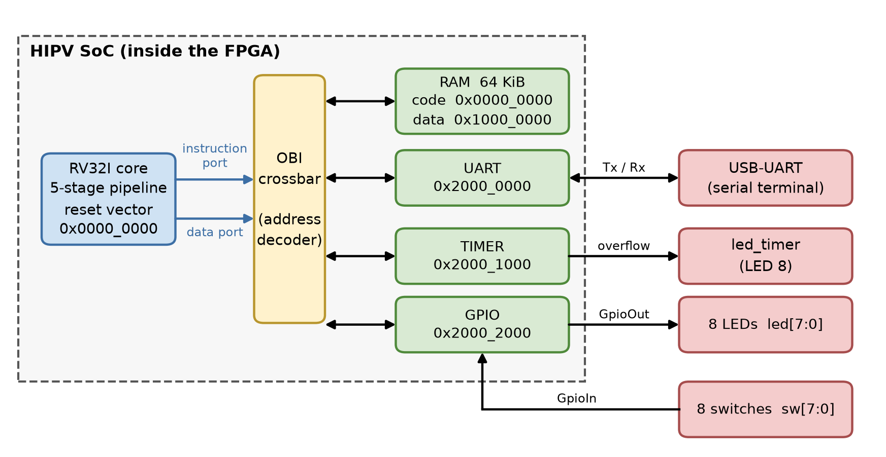

# Seventh laboratory exercise: HIPV SoC tutorial

In this exercise you meet the HIPV SoC: a small RISC-V computer that runs on your Nexys A7 board. You will find where its code lives, write a C program for it, build that program, run it first in simulation and then on the FPGA, and watch it blink the LEDs and talk over the UART.

Until now every design in this course was hardware that you described in SystemVerilog. This time the hardware is already written. What you write is **software**: a C program that the processor executes.

## Software and firmware

Two words are used throughout this chapter:

- **Software** is the C code you write, together with the toolchain that compiles it. It lives in the `sw/` directory of the HIPV repository.
- **Firmware** is the finished memory image (`firmware.hex`) that is built into the FPGA bitstream. After the build, the program is part of the hardware, much like the program of a router or a microcontroller.

You write software, and the build turns it into firmware.

## The HIPV SoC

HIPV is a *system on chip* (SoC): a processor, memory and peripherals connected by a bus, all inside one FPGA. @fig-hipv-soc shows the parts.

{#fig-hipv-soc width=100%}

- The **core** executes the RV32I instruction set (32-bit RISC-V, integer instructions only) in a five-stage pipeline.
- The **crossbar** routes the core's two bus ports, one for instructions and one for data, to the right peripheral, based on the address.
- The **RAM** holds both the program and its data. It is initialized with the firmware when the FPGA is configured.
- The **UART**, **timer** and **GPIO** are the peripherals. The program uses them by reading and writing addresses, which is called *memory-mapped I/O*.

On the board, the GPIO connects to the 8 slide switches and the 8 LEDs, and the UART connects to the USB cable that you also use to program the board.

## Step 1: Get the project and the tools

Clone the HIPV repository:

```bash
git clone https://github.com/RatkoFri/HIPV-SoC.git
cd HIPV-SoC
```

You need the tools from the first exercise (Anvil, `sv2v`, `openFPGALoader`) and a RISC-V compiler (`riscv64-unknown-elf-gcc`). How you get them depends on your computer:

| Your computer | Recommended setup |
|---|---|
| **Ubuntu / Linux** | Install the tools natively (`gcc-riscv64-unknown-elf` is the Debian and Ubuntu package name), or use the Docker image. Everything, including programming the board, works from the same terminal. |
| **macOS** and **Windows with WSL** | Use the Docker image to build, and program the board from the host. See the box below. |

The repository provides a Docker image that contains all the tools. Every `make` target in this chapter can be run inside the container by prefixing it with `docker-`, for example `make docker-sw APP=blink`. Build the image once with `make docker-build`; it downloads several gigabytes. See `README.md` in the repository for details.

::: {.callout-note}
## macOS and WSL

Docker on macOS and on Windows runs containers inside a virtual machine, and that machine cannot reach USB devices. The container can therefore build the firmware and the bitstream, but it cannot program the board. The workaround is to split the flow in two. The commands are the same on macOS and in a WSL terminal:

1. Build inside the container:

   ```bash
   make docker-fpga APP=blink
   ```

2. Program the board from the host with `openFPGALoader`, outside the container:

   ```bash
   brew install openfpgaloader     # macOS, once
   make program-host
   ```

   On WSL, install `openFPGALoader` in your WSL distribution instead of using `brew`, and forward the board's USB connection to WSL first (the *WSL only* steps in the first exercise). WSL does not see USB devices on its own.

In the rest of this chapter, replace `make APP=blink all` with the two commands above, and likewise for your own program. Compiling (`make APP=blink sw`) and simulation (`make run`) need no USB, so they work unchanged in the container.
:::

### Where things are

| Directory | What is there |
|---|---|
| `rtl/` | SystemVerilog source of the SoC: `core/`, `interconnect/`, `mem/`, `periph/`, `top/` |
| `config/` | Packages with parameters and the **address map** (`hipv_soc_pkg.sv`) |
| `sw/` | Software: the board support package (`bsp/`), the linker script (`link.ld`) and example programs (`examples/`) |
| `fpga/anvil/` | The FPGA top level (`top.sv`), the clock block and the pin constraints (`.xdc`) |
| `scripts/` | The build flow (`anvil_flow.py`) and the tool that converts a binary into a memory image (`mkmem.py`) |
| `tb/` | Testbenches and the simulation of whole programs |
| `docs/` | Documentation of the core, the bus, the memory and the FPGA flow |

This exercise touches only `sw/`. The other directories are there to read.

## Step 2: Memory map and peripherals

The processor sees everything as addresses. @tbl-memmap lists the address map from `config/hipv_soc_pkg.sv`.

| Block | Base address | Size |
|---|---|---|
| Code window (RAM) | `0x0000_0000` | 64 KiB |
| Data window (RAM) | `0x1000_0000` | 64 KiB |
| UART | `0x2000_0000` | 4 KiB |
| Timer | `0x2000_1000` | 4 KiB |
| GPIO | `0x2000_2000` | 4 KiB |

: HIPV address map. {#tbl-memmap}

The code window and the data window are two views of the same physical RAM. The core fetches instructions through the first and accesses data through the second. The linker script keeps code and data in different parts of it.

The registers that the exercise uses are listed in @tbl-regs. The complete list is in `sw/bsp/hipv.h`.

| Register | Address | Meaning |
|---|---|---|
| `GPIO_OUT` | `0x2000_2000` | Drives the LEDs. Can be read back. |
| `GPIO_IN` | `0x2000_2004` | The state of the switches. |
| `UART_TX` | `0x2000_0008` | Writing a byte starts sending it. |
| `UART_STATUS` | `0x2000_0010` | Bit 0 is set when the transmitter is idle. |

: The registers used in this exercise. {#tbl-regs}

In C, a register is a `volatile` pointer dereference. In `sw/bsp/hipv.h`:

```c
#define REG32(addr) (*(volatile uint32_t *)(addr))
#define GPIO_OUT    REG32(GPIO_BASE + 0x00)
```

So the C statement `GPIO_OUT = 0xFF;` is nothing more than a store word instruction to address `0x2000_2000`. That store goes through the crossbar to the GPIO, which turns on the LEDs.

You will rarely use the registers directly. The **board support package** (BSP, `sw/bsp/bsp.h`) wraps them in small functions:

| Function | What it does |
|---|---|
| `uart_init(baud)` | Sets the UART speed |
| `uart_putc(c)`, `uart_puts(s)` | Send a character, send a string |
| `print_hex8(v)` | Send a byte as two hexadecimal digits |
| `print_udec(v)` | Send an unsigned number in decimal |
| `gpio_write(v)` | Write the LEDs |
| `gpio_read_in()` | Read the switches |
| `timer_start()` | Start the free-running 64-bit timer |
| `delay_cycles(n)` | Wait for `n` clock cycles |

There is no C library. You cannot call `printf`, `malloc` or `strlen`, and the BSP is all the support there is.

## Step 3: The software side

### The example program

Open `sw/examples/blink/main.c`. After the comments it is only a few lines:

```c
int main(void)
{
    uart_init(BAUD);
    timer_start();

    while (1) {
        uart_puts("blink\n");
        for (int step = 0; step < STEPS; step++) {
            uint32_t pattern = 1u << step;
            gpio_write(pattern);
            print_hex8((uint8_t)pattern);
            uart_putc('\n');
            delay_cycles(DELAY_CYCLES);
        }
    }
}
```

It moves one lit LED across the board and prints the pattern for each step. The directory `sw/examples/blink/` contains only three files: `main.c`, a two-line `Makefile` that names the program and includes the shared rules in `sw/rules.mk`, and `expected.txt`, the output that simulation checks.

### Building

```bash
cd sw/examples/blink
make
```

The build leaves its products in `build/`:

| File | Content |
|---|---|
| `blink.elf` | The linked program with symbols |
| `blink.bin` | The raw machine code and data |
| `blink.hex` | The same, as a memory image: one 32-bit word per line, as hexadecimal text |
| `blink.lst` | The disassembly, with the C source interleaved |
| `blink.map` | Where the linker placed everything |

The `.hex` file is the firmware. The RAM in the SoC is initialized from it, as you will see in Step 5.

### What happens before `main`

Look at `sw/link.ld` and `sw/bsp/crt0.S`. The linker script places the code (`.text`) at address `0x0000_0000`, because the core starts executing at address 0 after reset. The data and the stack go into the data window. The start-up code `crt0.S` runs first. It sets the stack pointer, clears the uninitialized variables (`.bss`), and calls `main`.

Unlike on a PC, nothing loads the program. It is already in the RAM when the FPGA starts, so no copying of initialized variables is needed.

### Reading the disassembly

Open `build/blink.lst` and find the call to `gpio_write`. You will see something like:

```
lui   a5,0x20002      # a5 = 0x2000_2000, the GPIO base
sw    a0,0(a5)        # store the pattern into GPIO_OUT
```

That is the whole connection between the C program and the LEDs: a store to a particular address. The exact instructions depend on the compiler.

## Step 4: Run it in simulation first

Synthesizing for the FPGA takes minutes, so it is a slow way to find a bug. The repository can also run a program in a simulation of the whole SoC. From the example directory:

```bash
make run
```

The simulator boots the SoC with `build/blink.hex` as the RAM contents, watches the UART output pin, decodes the serial frames into characters and compares them to `expected.txt`. The run is long because every character takes thousands of clock cycles.

Use simulation for logic errors, such as wrong output text, and the board for what only the board can show, such as the real timing and the switches.

## Step 5: From firmware to the FPGA

On the board, the build flow takes the firmware, builds the SoC with it and programs the FPGA. From the root of the repository:

```bash
make APP=blink all
```

(On macOS and WSL, use the two-step flow from the box in Step 1 instead.)

`APP` is the name of a directory in `sw/examples/`. The `all` target runs three stages, which you can also run one by one:

| Command | What it does |
|---|---|
| `make APP=blink sw` | Compiles the software into `blink.hex` |
| `make APP=blink fpga` | Builds the bitstream with `blink.hex` as the RAM contents |
| `make APP=blink program` | Programs the board with the existing bitstream |

The default board is the Nexys A7-100T. If you have the Nexys A7-50T, add `BOARD=nexys-50t`.

Open a serial terminal on the board's USB serial port with **19200 baud, 8 data bits, no parity, 1 stop bit**. The name of the port depends on your system. Check which new device appears when you plug the board in:

| System | Port | Terminal program |
|---|---|---|
| Linux and WSL | `/dev/ttyUSB1` or similar | `screen /dev/ttyUSB1 19200` (leave `screen` with `Ctrl-A`, then `D`) |
| macOS | `/dev/cu.usbserial-...` | `screen /dev/cu.usbserial-XXX1 19200` (leave `screen` with `Ctrl-A`, then `K`) |

On Windows the serial port belongs to Windows, not to WSL, so open the terminal there even if you built the firmware in WSL.

You should see `blink` followed by the changing patterns, and the LEDs should chase one another at one step per second.

### What is different from a normal program

Compare this to a PC, or to the Microblaze flow of earlier years, where a program was downloaded to the running system:

- **The firmware is part of the bitstream.** The RAM is initialized with `blink.hex` while the FPGA is configured (the `INIT_FILE` parameter of the RAM). There is no separate program download.
- **Every change to the C program means a new bitstream**, and so another synthesis run. This is why simulation first is worth the time.
- **The clock must match.** The software knows the clock frequency from `CPU_HZ` (50 MHz by default, which is what the SoC runs at) and uses it to compute the UART speed and the delays. If you change the clock in the hardware, you have to give the same `CPU_HZ` to the software build. A mismatch does not stop the build. It shows up as garbled text in the terminal and wrong delays.

## Laboratory exercise

Write a program that runs forever, and once per second:

1. **toggles all eight LEDs** (all on, then all off, and so on), and
2. **reads the eight switches** and prints the state of both on one line over the UART.

A line of the output looks like this:

```
LED=FF SW=A5
LED=00 SW=A5
LED=FF SW=A1
```

### Steps

1. Create a directory for your program inside `sw/examples/`, and copy the starter files [main.c](../code/07_lab/main.c) and [Makefile](../code/07_lab/Makefile) into it:

   ```bash
   mkdir sw/examples/lab07
   cp main.c Makefile sw/examples/lab07/
   ```

   The `Makefile` expects to be one level below `sw/examples/`, like the other examples.

2. Complete the three `TODO` items in `main.c`. The functions you need are in the table in Step 2.

   - For the toggle, remember that the GPIO output register should always be written a full word at a time.
   - `print_hex8` takes a `uint8_t`, so cast the 32-bit values.

3. Build and try it in the simulator. In `main.c`, temporarily set `DELAY_CYCLES` to a small value such as `1000` (a full second is too long to simulate), then run `make run` in `sw/examples/lab07`. There is no `expected.txt` for this program, so the run only prints what the program sent over the UART. In simulation the switches are not pressed, so expect `SW=00`. Set `DELAY_CYCLES` back to `CPU_HZ` before going on.

4. Run it on the board from the repository root: `make APP=lab07 all`. Open the serial terminal, move the switches, and check that the printed `SW=` value follows them within a second.

### Questions

1. What is the address of the register that `gpio_write` writes to? Find the matching store instruction in `build/lab07.lst` and write down the instructions the compiler generated for it.
2. How many instructions does your main loop contain? Look at the listing. The core needs about three clock cycles per instruction. How long does one pass take apart from the `delay_cycles` call? Is it significant compared to the one-second delay?
3. What would happen if you changed `CPU_HZ` in the `Makefile` to `100000000` but did not change the hardware? Why does the build not report an error?
4. After you change one constant in `main.c`, which steps of the flow have to be repeated for the change to show up on the board?

### Optional extensions

- Print the switches in binary instead of hexadecimal (eight `0` and `1` characters).
- Let the switches choose the behavior: for example, `SW[0]` stops the toggling, and `SW[2:1]` selects the period (0.25, 0.5, 1 or 2 seconds).
- Use `timer_get()` to print the time since start-up in each line.
- Read `docs/ADDING_A_SLAVE.md` in the repository and sketch how you would add a new peripheral, such as a seven-segment display, to the SoC.

## Starter files

- [main.c](../code/07_lab/main.c)
- [Makefile](../code/07_lab/Makefile)
