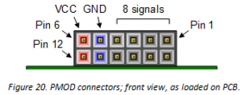
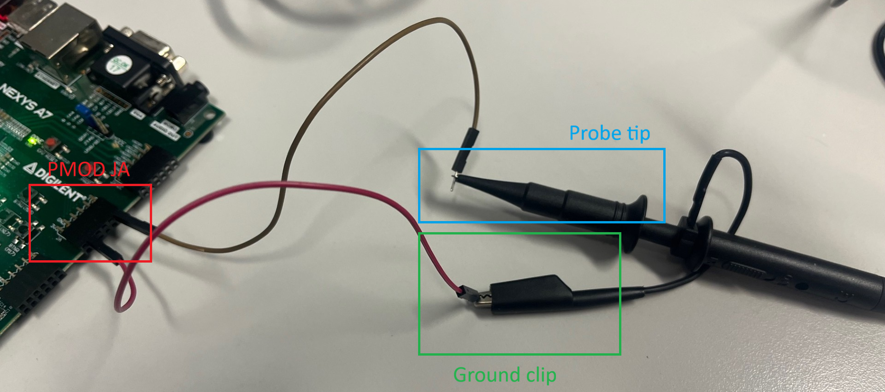
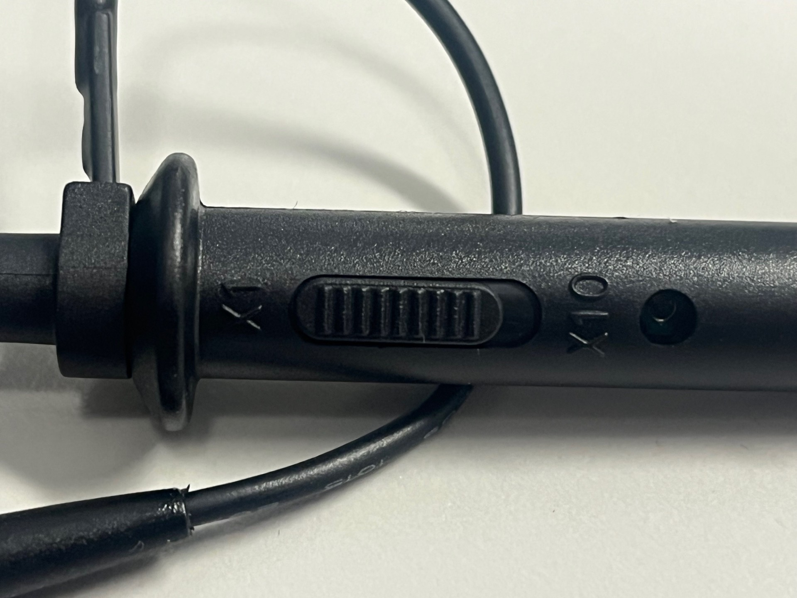
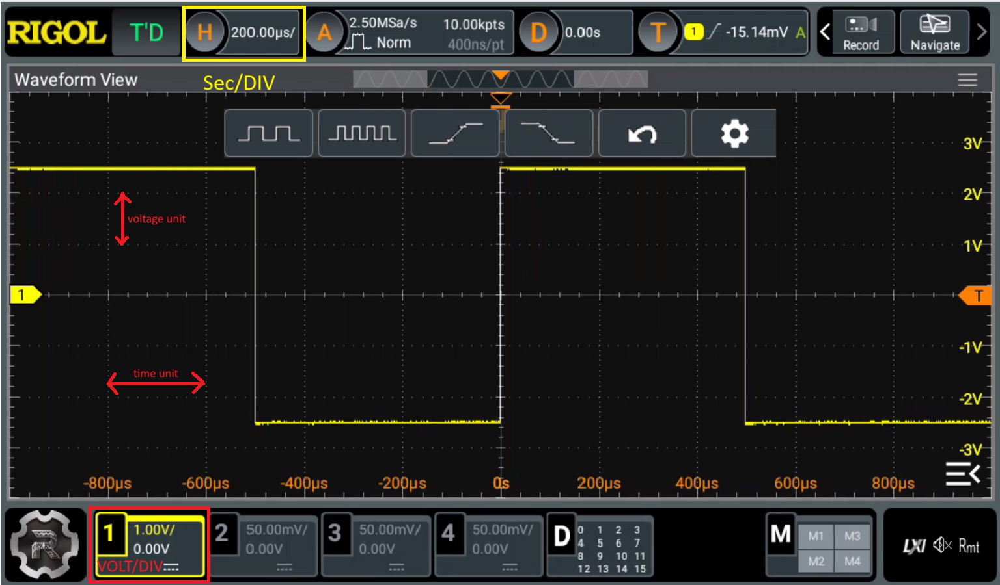
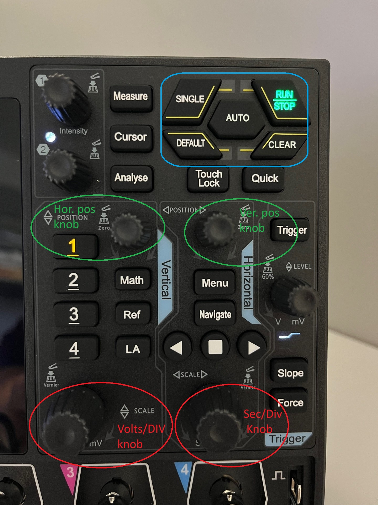
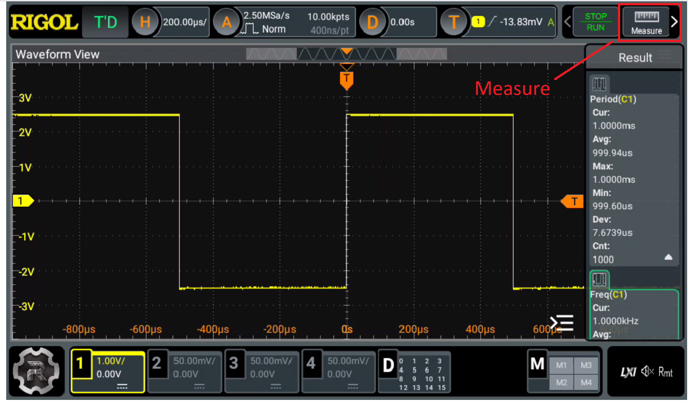
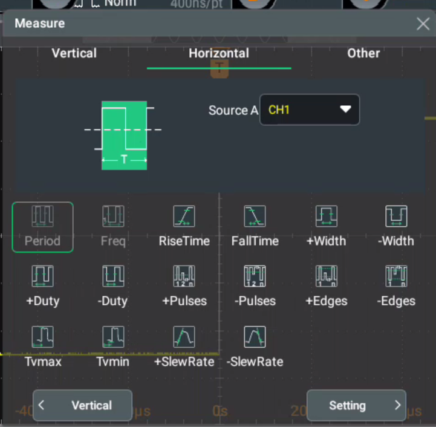
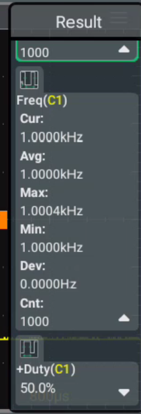
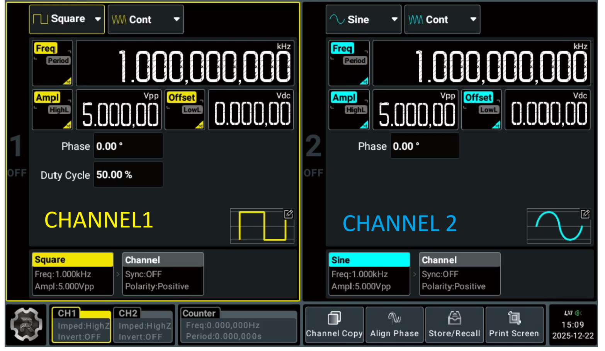
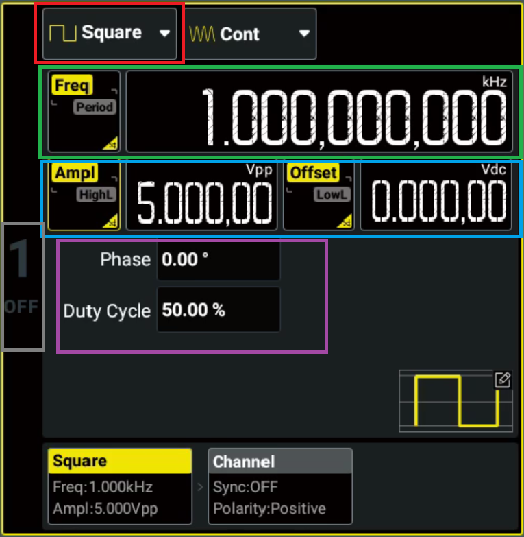

# Appendix: Using the Oscilloscope and Signal Generator

This appendix covers the two pieces of lab equipment you will connect to the FPGA board whenever an exercise asks you to probe a signal directly, starting with the oscilloscope extension in the [PWM RGB exercise](04-structural-modeling.qmd). The same equipment and the same Pmod probing convention come back again in the SoC verification lab later in the course.

## Equipment

- **Oscilloscope**: Rigol DHO914, a digital oscilloscope used to capture and analyze electrical signals in real time.
- **Signal generator**: Rigol DG912 Pro, used wherever an exercise asks you to compare a signal from the board against a known reference waveform.

Simulation only shows how a design behaves in an idealized model. Real hardware adds effects simulation cannot show you: clock jitter, I/O delays, signal integrity issues, and interaction with external peripherals. Measurement equipment lets you check timing, frequency, and duty cycle against the actual signal coming off the board, not just the one your testbench predicts.

::: {.callout-warning title="Power-on order"}
Turn the equipment on in this order: oscilloscope first, then the signal generator, then the FPGA board. Powering them on in a different order risks damaging the equipment.
:::

## Connecting probes to the FPGA board

Several exercises route the signal to observe out through the JA Pmod header, using pin 1 as the signal and pin 5 as ground. The pinout is:

- Connect the oscilloscope probe's ground clip to the GND pin (pin 5) of the JA Pmod header.
- Connect the probe tip to the signal pin (pin 1) of the JA Pmod header, for example the `pwm_out` signal from the [PWM RGB exercise](04-structural-modeling.qmd).
- Also connect the FPGA board's ground to the oscilloscope's ground, so both share a common reference point.

Set the probe's attenuation switch to 1X. A 10X setting attenuates the signal before it reaches the oscilloscope and will distort your reading.

If an exercise also asks you to compare against a reference signal from the signal generator, connect the generator's output (CH1) to the oscilloscope's second channel (CH2) with a BNC cable.

## Using the Rigol DHO914 oscilloscope

When you power on the oscilloscope, the main screen displays the waveforms captured on each channel.

The yellow box next to the RIGOL logo in the lower left corner shows which channel is currently selected, CH1 in the image above. Press a channel's button on the front panel to select it. Each channel has its own vertical scale, coupling, and position settings.

### Adjusting the display

The waveform grid's horizontal axis is time, the vertical axis is voltage.

- The **Sec/DIV** knob sets the time scale, how much time one horizontal grid division represents.
- Each channel's **Volts/DIV** knob sets that channel's voltage scale, how much voltage one vertical grid division represents.
- Each channel's **Position** knob, and the **Horizontal Position** knob, move the waveform on screen without changing its scale. Use them to center a waveform for a closer look.
- The **Auto** button automatically picks scale and position settings for whatever signal is connected. It's a good starting point when you aren't yet sure what the signal looks like.
- The **Run/Stop** button freezes the current acquisition. Press it again to resume capturing.

### Measuring signal parameters

Press the **Measure** button (or the Measure knob, to the left of the Auto button) to open the measurement menu.

Measurements are grouped into three categories:

- **Vertical**: voltage-related measurements such as Vmax, Vmin, Vavg, Vpp, and Vrms.
- **Time**: time-related measurements such as Frequency, Period, Rise Time, Fall Time, and Duty Cycle.
- **Other**: delay, phase, and similar cross-channel measurements.

Select the parameters relevant to what you're verifying. For a PWM signal that is usually Period, Freq, and +Duty.

Close the measurement menu once you've made your selections. The chosen measurements stay on screen on the right side of the waveform display and update live as the oscilloscope keeps capturing.

## Using the DG912 Pro signal generator

The DG912 Pro outputs sine, square, triangle, pulse, noise, DC, and arbitrary waveforms through two channels, CH1 and CH2. Most exercises only need CH1.

For each channel you can set:

- **Waveform type**: square, sine, triangle, ramp, pulse, noise, DC, or arbitrary.
- **Frequency**: press **FREQ**, enter the value on the numeric keypad, and confirm with **ENTER**.
- **Amplitude**: press **VPP** to set the peak-to-peak voltage, or **OFFSET** to set the DC offset the waveform is centered around. An offset of 0V means the waveform swings between +VPP/2 and -VPP/2. The **Ampl/HighL** button switches between VPP/offset and high/low voltage level entry, whichever is more convenient for the levels you need.
- **Duty cycle** (square waves): press **DUTY**, enter a percentage from 0 to 100, and confirm with **ENTER**. Duty cycle is the fraction of one period the signal spends high. 50% means high for half the period and low for the other half.
- **Phase**: press **PHASE** and enter a value in degrees from 0 to 360, the shift of the waveform relative to a reference point in time.

Once configured, enable the channel's output by pressing the gray area next to it. It lights up yellow when the output is active.

> To match a 3.3V FPGA output level on a reference channel, set VPP to 3.3V and Offset to 1.65V, so the signal swings from 0V to 3.3V instead of being centered on 0V.
