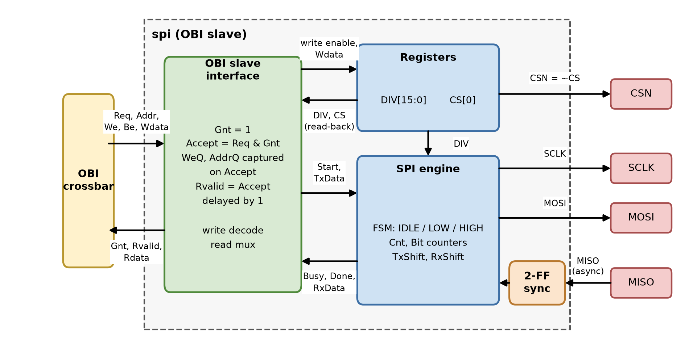

# Homework 2: Extending the HIPV SoC {#sec-hw2}

In the first homework you extended the **core** with new instructions. In this homework you extend the **SoC around it**. You add two things that every real microcontroller has:

- **Task 1** gives the **UART** hardware FIFOs. At the moment the UART holds one byte in each direction, so a program that is busy for a few milliseconds loses incoming characters, and every outgoing character blocks the program until it has been sent.
- **Task 2** adds a new peripheral, an **SPI master**, and connects it to the accelerometer on the Nexys A7 board. You also write the C driver for it.

The two tasks are independent, and you can do them in either order. Task 2 repeats the procedure of the previous lab exercise (adding a slave to the SoC), but with a peripheral that is much more than a bank of registers.

::: {.callout-note title="Homework"}
This is a graded homework (30 points), not a lab exercise. The code lives in the `HIPV-SoC` repository, branch `hw2-student`.
:::

## Before you start

**1. Update Anvil.** Run `anvil update` once on your own computer. On the classroom computers you cannot do this; use the classroom patch from the [Tools introduction](01-tools-intro.qmd).

**2. Get the `hw2-student` branch.**

```sh
git clone <HIPV-SoC repository URL>     # skip if you already have a clone
cd HIPV-SoC
git fetch origin
git checkout hw2-student                # or: git switch hw2-student
git status                              # should say: On branch hw2-student
```

The branch is based on the project as it was at the end of the previous lab exercise. It does not contain your solution of homework 1. The core is the plain RV32I core, and this homework does not need the extensions.

**3. Tools.** The same as in homework 1: Verilator 5.036 or newer, cocotb 2.x, and a recent RISC-V GCC. Run the check once:

```sh
python3 scripts/check_setup.py
```

**4. Reading.**

- Lecture notes posted on Ucilnica (E-classroom).
- In the repository: `docs/ADDING_A_SLAVE.md`, `docs/INTERCONNECT.md`, and the OBI slave section of `rtl/periph/README.md`.
- The previous lab exercises: *UART transmitter* (the UART frame), and *Adding a 7-segment display to the HIPV SoC* (the OBI slave interface and the integration steps).
- For Task 2: the SPI and accelerometer sections of the [Nexys A7 reference manual](https://digilent.com/reference/programmable-logic/nexys-a7/reference-manual), and the datasheet of the ADXL362 accelerometer (Analog Devices).

**5. Existing tests must pass.** Before you change anything, run the regression testbenches. They must pass:

```sh
cd tb/soc && make
cd tb/fpga && make
```

## What is provided

| File | What it is |
|---|---|
| `rtl/periph/fifo.sv` | Task 1 skeleton with the **fixed interface** of the FIFO |
| `tb/unit/fifo/` | Testbench for the `fifo` module |
| `tb/unit/uart/` | Testbench for the UART register interface, with a host-side serial model |
| `tb/unit/spi/` | Testbench for the SPI master, with a Python SPI slave model |
| `tb/common/spi_slave.py` | The SPI slave model, so that you can reuse it in your own tests |
| `sw/hw2/uart_check/` | Self-checking C program for Task 1, run on the SoC |
| `sw/hw2/spi_check/` | Self-checking C program for Task 2, run on the SoC with MOSI connected to MISO |
| `sw/hw2/accel/` | Skeleton of the accelerometer program for the real board (not graded) |
| `fpga/anvil/Nexys-A7-100T-Master.xdc` | Already contains the accelerometer pin names, which you enable in Task 2 |

### Where to change the code

Every place you have to change is marked in the source with a comment starting with `HW2 Task 1` or `HW2 Task 2`. The comments say *where* to work, not *what* to write. List them with:

```sh
grep -rn "HW2 Task" config rtl fpga sw
```

If you add another RTL file, add it to the `VERILOG_SOURCES` of every testbench that needs it (`tb/unit/*`, `tb/soc`, `tb/fpga`), and to the `RTL` list in `scripts/anvil_flow.py`. The build script does not search for sources.

---

## Task 1: UART with FIFOs

### The problem

The UART of the SoC receives one byte at a time and keeps it in a one-byte buffer until the program reads it. If a second byte arrives before the first is read, the first is lost. In the other direction, the program must wait until the transmitter is empty before it may write the next byte, so printing a 40-character line keeps the processor busy for the whole time of the transfer, which is about 0.5 ms for each character at 19200 baud (10 bits per frame).

A **FIFO** (first in, first out buffer) decouples the two sides. The program writes characters into the transmit FIFO and carries on. The transmitter takes them out one by one. In the receive direction the receiver puts characters into the receive FIFO, and the program reads them when it has time.

### The FIFO module

Write `fifo.sv` with the following fixed interface:

| Port | Direction | Meaning |
|---|---|---|
| `clk`, `reset` | in | Clock and active-high synchronous reset |
| `Push` | in | Store `Din` in the FIFO |
| `Din[WIDTH-1:0]` | in | Data to store |
| `Pop` | in | Remove the oldest entry |
| `Dout[WIDTH-1:0]` | out | The **oldest entry**, valid whenever `Empty` is 0 (first-word fall-through: no read cycle is needed) |
| `Empty` | out | No entries |
| `Full` | out | `DEPTH` entries |
| `Level[$clog2(DEPTH):0]` | out | Number of entries |

The parameters are `WIDTH` (default 8) and `DEPTH` (default 16, always a power of two).

The behavior in the corner cases is part of the specification, and the hidden tests check it:

- `Push` while `Full` is **ignored**, even if `Pop` is high in the same cycle.
- `Pop` while `Empty` is **ignored**.
- `Push` and `Pop` in the same cycle, when the FIFO is neither empty nor full, leave `Level` unchanged.
- `Push` and `Pop` in the same cycle when the FIFO is empty store the new entry and ignore the pop.
- After `reset` the FIFO is empty.

### The new UART registers

The register map of the UART keeps its first five registers. `TX` and `RX` now access the FIFOs, `STATUS` has new bits, and one register is added:

| Offset | Register | Description |
|---|---|---|
| `0x00` | `CONF` | unchanged |
| `0x04` | `SPEED` | unchanged |
| `0x08` | `TX` | **Write:** put bits 7:0 into the TX FIFO. If the FIFO is full, the byte is dropped and `TX_OVERFLOW` is set. **Read:** returns 0. |
| `0x0C` | `RX` | **Read:** removes the oldest byte from the RX FIFO and returns it in bits 7:0. If the FIFO is empty, returns 0 and removes nothing. |
| `0x10` | `STATUS` | see below |
| `0x14` | `LEVEL` | Bits 4:0: number of bytes in the TX FIFO. Bits 20:16: number of bytes in the RX FIFO. |

Bits of `STATUS`:

| Bit | Name | Meaning |
|---|---|---|
| 0 | `TX_EMPTY` | The TX FIFO is empty (the last byte may still be on the wire) |
| 1 | `RX_AVAIL` | The RX FIFO is not empty |
| 2 | `TX_FULL` | The TX FIFO is full |
| 3 | `RX_FULL` | The RX FIFO is full |
| 4 | `RX_OVERRUN` | A received byte was dropped because the RX FIFO was full. **Sticky:** cleared by writing 1 to this bit of `STATUS`. |
| 5 | `TX_OVERFLOW` | A byte written to `TX` was dropped because the TX FIFO was full. Sticky, cleared in the same way. |

Bits 0 and 1 keep their old meaning, so programs that only use them keep working.

### What to change

1. **The FIFO.** Write `fifo.sv`. Think about the storage first. A read pointer, a write pointer and a small array is the usual structure. Decide how you tell *full* from *empty* when the pointers are equal.
2. **The UART.** Replace the one-byte buffers in `rtl/periph/uart_system.sv` and `rtl/periph/uart.sv` by two FIFOs. The transmitter takes a byte out of the TX FIFO whenever it is idle and the FIFO is not empty. The receiver pushes every byte it receives into the RX FIFO.
3. **The register interface.** Add the `LEVEL` register and the new `STATUS` bits.
4. **The BSP.** Update `uart_putc` in `sw/bsp/bsp.c` so that it waits only while the TX FIFO is *full*, and not until the transmitter is empty.

Three questions guide the integration. Answer them in the report.

1. **When does a read of `RX` remove the byte?** The OBI slave has an address phase and a response phase one cycle later. A read has a side effect now. Which phase should the pop happen in? What goes wrong if you pop in the other one, for example when a read of the empty FIFO is followed immediately by a read of a FIFO that just received a byte?
2. **What does the processor see when a byte arrives in the cycle of a read?** Show the order in which the FIFO is updated, so that the byte is neither lost nor read twice.
3. **How large must the FIFO be?** The program prints a line of 40 characters. Explain what happens with a 16-entry TX FIFO and the original `uart_putc`, and what happens with your `uart_putc`. How long does `uart_puts` take in each case?

### Testing Task 1

```sh
cd tb/unit/fifo && make                 # unit level: the FIFO alone
cd tb/unit/uart && make                 # unit level: registers, FIFOs, serial side
cd sw/hw2/uart_check && make run        # SoC level: the C check
```

| Test | What it checks |
|---|---|
| `tb/unit/fifo`: `test_basic`, `test_corner_cases` | order of the data, `Level`, `Empty` and `Full` flags, the corner cases listed above |
| `tb/unit/fifo`: `test_random` | thousands of random pushes and pops against a Python queue |
| `tb/unit/uart`: `test_tx_burst` | 16 writes to `TX` without waiting, all 16 characters appear in order on the pin |
| `tb/unit/uart`: `test_tx_overflow` | the 17th write is dropped and sets `TX_OVERFLOW`; the flag is sticky and cleared by writing 1 |
| `tb/unit/uart`: `test_rx_burst` | the host model sends 16 frames back to back, the program reads them later, in order |
| `tb/unit/uart`: `test_rx_overrun` | a 17th frame sets `RX_OVERRUN`, the first 16 bytes are intact |
| `tb/unit/uart`: `test_read_empty` | a read of an empty `RX` returns 0 and does not disturb a byte that arrives next |
| `tb/unit/uart`: `test_status_compat` | bits 0 and 1 of `STATUS` behave as before |
| `sw/hw2/uart_check` | prints a long text with `uart_puts` and times it; echoes a burst of characters that the testbench sends back to back |

---

## Task 2: SPI master

### Background

**SPI** (Serial Peripheral Interface) is the standard interface between a processor and a sensor, a flash memory, or a display. A **master** (your peripheral) drives the clock, and one or more **slaves** answer. It uses four wires:

| Signal | Direction (master) | Meaning |
|---|---|---|
| `SCLK` | out | Serial clock, generated by the master |
| `MOSI` | out | Master out, slave in: data to the slave |
| `MISO` | in | Master in, slave out: data from the slave |
| `CSN` | out | Chip select, **active low**: the slave listens only while it is low |

Data goes in both directions at the same time. In every `SCLK` period the master sends one bit and receives one bit.

This homework uses **mode 0** (CPOL = 0, CPHA = 0), **8 bits per transfer, most significant bit first**:

- `SCLK` is **low** when idle.
- Data changes on the **falling** edge of `SCLK` and is sampled on the **rising** edge.

On the Nexys A7 board, the SPI master is connected to the ADXL362 accelerometer. The pins are `ACL_SCLK`, `ACL_MOSI`, `ACL_MISO` and `ACL_CSN` in the master constraints file.

### Register map

The peripheral sits at base address **`0x2000_4000`** (slave index 6, 4 KiB). The address is fixed, so that the hidden tests find the peripheral. The branch already contains it in `config/hipv_soc_pkg.sv` and in the decoder, so you do **not** repeat that part of the previous exercise. You still have to connect the new slave in `hipv_soc.sv` and the board wrapper.

| Offset | Register | Description |
|---|---|---|
| `0x00` | `DIV` | Bits 15:0: clock divider. `SCLK` changes every `DIV + 1` SoC clock cycles, so `f_SCLK = f_clk / (2 · (DIV + 1))`. Reset value 24 (1 MHz at 50 MHz). Changing it while `BUSY` is 1 is not allowed. |
| `0x04` | `CS` | Bit 0: 1 drives `CSN` low (selected), 0 drives it high. Reset value 0. |
| `0x08` | `DATA` | **Write:** bits 7:0 are sent, and a transfer starts. Ignored while `BUSY` is 1. **Read:** the byte received in the last finished transfer. |
| `0x0C` | `STATUS` | Bit 0 `BUSY`: a transfer is running. Bit 1 `DONE`: a transfer has finished since the last write to `DATA`. Cleared when a transfer starts. |

All registers return 0 in the bits that are not listed. Every access, including a write that is ignored, gets a response from the OBI slave interface.

`CS` is controlled by software and is not part of the transfer. A typical transaction with the accelerometer has several bytes, with `CSN` low for the whole time.

### Timing of one transfer

Let `T = DIV + 1` clock cycles. After the write to `DATA` is accepted:

- `BUSY` goes high in the next cycle, and `MOSI` shows bit 7.
- For each of the eight bits, from bit 7 down to bit 0: `MOSI` holds the bit for `T` cycles, then `SCLK` goes high for `T` cycles, then low. `MISO` is sampled in the cycle in which `SCLK` rises.
- `MOSI` changes in the cycle in which `SCLK` falls, to the next bit.
- At the **falling edge after the eighth bit**, `BUSY` goes low, `DONE` goes high, and the received byte becomes visible in `DATA`.

So one transfer takes exactly `16 · T` cycles, from the first cycle with `BUSY` high to the last. `SCLK` stays low while idle.

### Structure of the peripheral

@fig-spi-block shows what is inside `spi.sv`. It has the same three layers as the 7-segment peripheral from the previous exercise, plus a synchronizer on the input.

{#fig-spi-block width=100%}

- **OBI slave interface.** It accepts every request in one cycle (`Gnt = 1`), remembers the register index and the write flag, and answers one cycle later with `Rvalid`. It also decodes writes into write enables and selects the read data. This is the block you copy from the other peripherals.
- **Registers.** `DIV` and `CS` are ordinary registers written from the bus and read back. `CS` goes straight to the `CSN` pin, inverted, so a transaction can keep the chip selected across several transfers.
- **SPI engine.** It contains the state machine, the two counters and the two shift registers. A write to `DATA` is not stored in a register of its own. It becomes a `Start` pulse with the byte, and the engine returns `Busy`, `Done` and the received byte, which the read mux puts in `STATUS` and `DATA`.
- **Synchronizer.** `MISO` comes from the sensor and is not aligned with the SoC clock, so it passes through two flip-flops before the engine samples it.

The bus side and the engine only meet at the `Start`, `Busy`, `Done` and data signals. You can therefore test the engine without the bus, and the bus interface without the engine.

### A suggested control unit

The timing above can be produced by a small state machine and two counters. The unit below is one straightforward way to do it. Other designs are fine as long as they keep the timing.

{#fig-spi-fsm width=100%}

| State | Meaning | `BUSY` | `SCLK` |
|---|---|---|---|
| `IDLE` | no transfer; waiting for a write to `DATA` | 0 | 0 |
| `LOW` | first half of a bit period: `MOSI` shows the current bit, `SCLK` is low | 1 | 0 |
| `HIGH` | second half of a bit period: `SCLK` is high | 1 | 1 |

Transitions:

- **`IDLE → LOW` on a write to `DATA`.** The transmit shift register is loaded with the written byte, and both counters are cleared. `MOSI` is the top bit of the shift register, so bit 7 is on the pin from the first cycle in `LOW`. A write is accepted only in `IDLE`.
- **`LOW → LOW` while `Cnt` ≠ `DIV`.** The state lasts `DIV + 1` cycles, which is `T`.
- **`LOW → HIGH` when `Cnt` = `DIV`.** `SCLK` rises. In this same cycle `MISO` is sampled into the receive shift register.
- **`HIGH → HIGH` while `Cnt` ≠ `DIV`.** The same counter again.
- **`HIGH → LOW` when `Cnt` = `DIV` and `Bit` ≠ 7.** `SCLK` falls, the transmit shift register shifts left so the next bit appears on `MOSI`, and `Bit` is incremented.
- **`HIGH → IDLE` when `Cnt` = `DIV` and `Bit` = 7.** The eighth bit is complete. `SCLK` falls, `BUSY` goes low, `DONE` is set, and the received byte becomes the value that a read of `DATA` returns.

Count the cycles to check the diagram against the timing rules: the machine spends `T` cycles in `LOW` and `T` cycles in `HIGH` for each of the eight bits, which is the required `16 · T` cycles in total.

The three outputs of the state machine are the enable for the shift registers, the `SCLK` level, and the clear for the counters. `BUSY` is high in every state except `IDLE`, so it does not need a register of its own.

### What to change

1. **The module.** Write `rtl/periph/spi.sv`. It has the OBI slave interface of the other peripherals, the register logic, and a shift register with a clock divider and a bit counter. Reuse `flopenr` and the `counter` from `rtl/generic/`. Use the same OBI slave interface block as in the previous exercise, and the same coding conventions as the other files in `rtl/periph/`.
2. **The SoC.** Instantiate `spi` in `rtl/top/hipv_soc.sv` at slave index `SLAVE_SPI`, and add the four pin ports to the module.
3. **The board.** Add the ports to `fpga/anvil/top.sv`, and enable the accelerometer pins in `fpga/anvil/Nexys-A7-100T-Master.xdc`. Take the pin locations from the comment lines for `ACL_*` in that file. Remember that `spi.sv` must be added to the file list of the build script.
4. **The driver.** Write `spi_init`, `spi_cs`, and `spi_transfer(byte)` in the BSP (`sw/bsp/`). `spi_transfer` must wait for `BUSY` to go low and return the received byte. Then write a function `accel_read(reg)` that reads one register of the ADXL362 (see below).

The input `MISO` comes from outside the FPGA and is not synchronous to the SoC clock. **Synchronize it** before it reaches your logic. Explain in the report where and why.

### The accelerometer (hardware part, not graded)

The ADXL362 uses SPI mode 0 and a very simple command format. With `CSN` low, the master sends:

- the command byte `0x0B` (read) or `0x0A` (write),
- the register address,
- and then, for a read, one dummy byte for each register to read. The slave returns the register contents during the dummy bytes.

Three read-only registers hold an identification. Registers `0x00`, `0x01` and `0x02` read as `0xAD`, `0x1D` and `0xF2`. Writing `0x02` to register `0x2D` (`POWER_CTL`) puts the sensor in measurement mode, and then the acceleration is available from register `0x08` (the X axis, 8 bits) onwards.

`sw/hw2/accel` shows the skeleton of a program that prints the identification bytes and then the three axes twice a second. It is not graded, because it can only be tested on the board, but if your device-ID line shows `AD 1D F2`, your SPI master works with a real sensor. Tilt the board and watch the numbers change.

### Testing Task 2

```sh
cd tb/unit/spi && make                  # unit level: the SPI master with a slave model
cd sw/hw2/spi_check && make run         # SoC level: loopback test from C
```

| Test | What it checks |
|---|---|
| `test_registers` | reset values, read-back of `DIV` and `CS`, unused bits read as 0 |
| `test_cs` | `CSN` follows the `CS` register |
| `test_idle` | `SCLK` is low and `BUSY` is 0 when idle |
| `test_transfer_all_bytes` | all 256 values go out MSB first on `MOSI`, sampled on rising edges by the slave model |
| `test_receive` | the slave model sends random bytes, the master receives them correctly |
| `test_clock_period` | `SCLK` period equals `2 · (DIV + 1)` clock cycles for several values of `DIV`, including 0 |
| `test_busy_timing` | `BUSY` is high for exactly `16 · (DIV + 1)` cycles |
| `test_write_while_busy` | a write to `DATA` during a transfer changes nothing |
| `test_back_to_back` | a new write in the cycle after `BUSY` falls |
| `test_async_miso` | `MISO` changes asynchronously in the test; the received byte must still be a valid sample |
| `sw/hw2/spi_check` | the testbench connects `MOSI` to `MISO`. The program sends every byte value and checks that it receives the same value. |

---

## Rules

- Use only the modules in the repository and the SystemVerilog constructs already used in it. Keep the coding conventions of the project (the same as in the previous exercises): active-high synchronous reset, `flopenr` for registers, no latches.
- The testbenches run Verilator with `-Wall`, and every warning is an error. Do not switch warnings off globally.
- Do not change the interfaces that the provided testbenches use: the ports of `fifo`, the register map, and the pin names.
- The provided tests are a start, not the whole story. Your design is also graded with **additional hidden tests of the same kind and at the same levels**: more operand values, other `DIV` values, other timing of the bus accesses. Write **your own tests** for the corner cases that you can think of, such as a new testbench for a part that has none. Copies of the provided tests do not count.
- At the end, run every testbench once more: `tb/unit/fifo`, `tb/unit/uart`, `tb/unit/spi`, `tb/soc` and `tb/fpga`.
- The design must still go through the FPGA flow (`make APP=hw2/uart_check fpga`) and meet the timing at the default 50 MHz.

## Report

Submit a PDF of at most **2 pages**. Describe your design choices and the results of your tests. It must contain:

- the answers to the three questions in Task 1,
- the explanation of the synchronizer for `MISO` in Task 2,
- a short description of your own tests and the cases they cover,
- the output of the benchmark of `uart_puts` for the old and the new UART, as a small table.

## Grading

The homework is worth **30 points**.

| Part | Points |
|---|---|
| Task 1: provided and hidden tests | 11 |
| Task 2: provided and hidden tests | 11 |
| Your own tests (new cases, not copies) | 2 |
| Report | 4 |
| Code quality | 2 |
| **Total** | **30** |

## Submission

- Submit a single ZIP file with your **modified RTL and newly created testbench files**, the **modified BSP and software files**, and the **report PDF**. Do not include the provided tests, the rest of the SoC, or the FPGA flow.
- The ZIP file must be named `hw2_team_<team_name>.zip`, for example `hw2_team_H.zip`.
